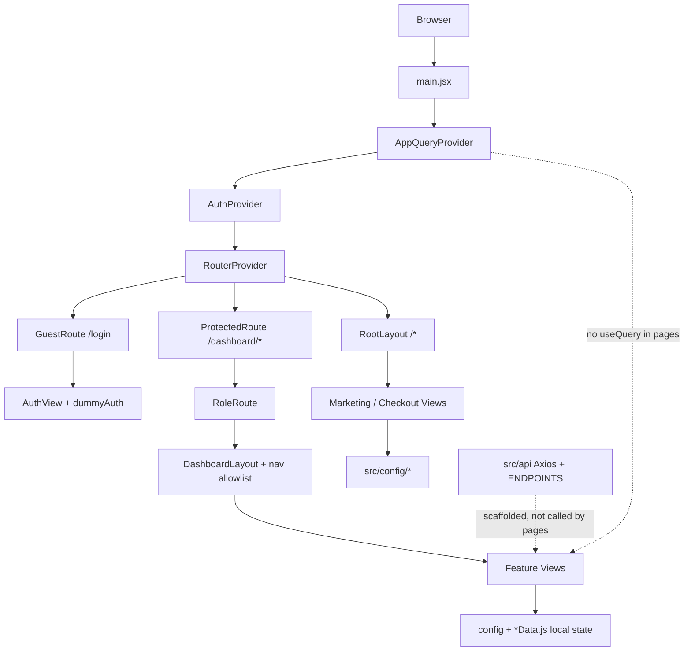
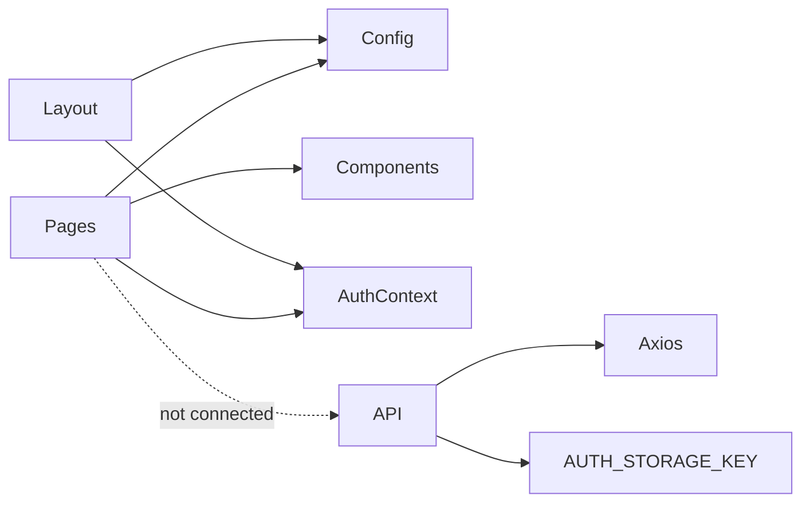

# Frontend E2E Analysis

**Product:** NovaSky (telecom / eSIM portal + multi-role dashboards)  
**Repository:** `diams`  
**Analysis date:** 2026-09-22  
**Scope:** Frontend only — investigation, no code changes  
**Evidence basis:** Source inspection of `package.json`, `src/**`, configs, `doc/BACKEND_INTEGRATION.md`, `README.md`

---

## 1. Executive Summary

NovaSky is a **Vite + React 19 SPA** with a polished **config-driven UI** covering public marketing/checkout, and three role dashboards (admin, collaborator, user). Authentication is **demo-only** (`localStorage` + hardcoded users in `src/config/dummyAuth.js`). An **Axios + TanStack Query API layer** is scaffolded and documented (`src/api/*`, `doc/BACKEND_INTEGRATION.md`) but **no page currently calls live APIs** — dashboards mutate in-memory mock data from `*Data.js` / `src/config/*`.

**Highest-impact realities:**

1. Backend integration is prepared but unused; UI looks complete while data is local/mock.
2. Several footer/CTA links (`/esim`, `/about`, `/careers`, `/press`, `/partners`) have **no routes** → public 404.
3. Checkout has a **missing Review step** (defined in `CHECKOUT_STEPS`, skipped by payment → confirmation) and **no cross-step state persistence**.
4. `DashboardLayout` nav allowlist **blocks** registered routes not listed in `DASHBOARD_NAV` (collaborator identity/plans/support; user notifications).
5. No automated tests; TypeScript not used; `chart.js` / `lucide` / Lenis SmoothScroll are largely unused dead weight.

---

## 2. Project Overview

| Item | Value |
|------|-------|
| App name (package) | `basic` (`package.json`) |
| Product branding | NovaSky |
| Module type | ES modules (`"type": "module"`) |
| Entry HTML | `index.html` → `/src/main.jsx` |
| Source language | JavaScript + JSX only |
| Approx. size | ~351 `.jsx` + ~91 `.js` under `src/` |
| Config content modules | 36 files in `src/config/` |
| Mock data modules | 21 `*Data.js` files under dashboards |
| Shared components | 34 files under `src/Components/` |
| Docs | `README.md`, `doc/BACKEND_INTEGRATION.md` |
| Live demo (README) | https://nova-sky.maktechgroup.tech/ |

**Character of the codebase:** Marketing + checkout funnel + dense admin/collaborator/user dashboards built as **UI prototypes with mock data**, with a clear intended path to wire Axios/TanStack Query later.

---

## 3. Technology Stack

### Confirmed stack (used in code)

| Concern | Technology | Version (package.json) | Evidence of use |
|---------|------------|------------------------|-----------------|
| UI library | React / React DOM | ^19.2.0 | `src/main.jsx` |
| Build | Vite | ^7.2.4 | `vite.config.js`, scripts |
| CSS | Tailwind CSS v4 + `@tailwindcss/vite` | ^4.1.18 | `src/index.css` `@import "tailwindcss"`, `@theme` |
| Routing | React Router | ^7.18.2 | `createBrowserRouter` in `src/router/routes.jsx` |
| HTTP | Axios | ^1.20.0 | `src/api/axiosInstance.js` (unused by pages) |
| Server-state kit | TanStack React Query | ^5.102.8 | `AppQueryProvider` mounted; no page queries |
| Forms | react-hook-form | ^7.88.0 | Auth + a few dashboard forms |
| Validation | Zod + `@hookform/resolvers` | ^4.6.5 / ^5.9.1 | `src/lib/formSchemas.js` |
| Charts | Recharts | ^3.10.1 | Admin/collaborator overview + reports |
| Icons | lucide-react | ^0.562.0 | Widespread |
| Icons (limited) | react-icons | ^5.7.0 | Auth Google icon, Footer socials, WhatsApp |

### Declared but unused / weakly used

| Dependency | Status | Evidence |
|------------|--------|----------|
| `chart.js` + `react-chartjs-2` | **Unused** | No imports under `src/` |
| `lucide` (non-React) | **Unused** | Only `lucide-react` imported |
| `lenis` | **Installed; SmoothScroll unused** | `src/Components/utility/SmoothScroll.jsx` exists; not mounted in `main.jsx` |
| Framer Motion | **Documented in README, not in package.json** | README claims motion; dependency absent |

### Not present

| Concern | Finding |
|---------|---------|
| State store (Redux/Zustand/Jotai) | Not used; only Auth Context |
| TypeScript | No `.ts`/`.tsx`; `jsconfig.json` for path alias only |
| i18n | No library; English copy in config/JSX |
| Testing | No Vitest/Jest/Cypress/Playwright; no `*.test.*` |
| PropTypes | None |
| UI kit (MUI/Chakra/shadcn) | None — custom Tailwind components |
| Prettier | No Prettier config found |
| Stylelint | None |

### Role of major dependencies

- **React 19 + Vite 7:** SPA bootstrap and HMR/build.
- **Tailwind v4:** Design tokens in `@theme` (`--color-primary`, `--color-btnPrimary`, Poppins font).
- **React Router 7:** Nested public / guest / protected / role routes.
- **Axios + CRUD helpers:** Prepared for backend; interceptors expect JWT fields never set by dummy auth.
- **TanStack Query:** Provider + helpers (`queryKeys`, `ApiStateGate`) ready; unused at UI layer.
- **RHF + Zod:** Partial adoption (login, password change, tickets, collaborator profile).
- **Recharts:** Dashboard analytics visuals from mock series.
- **lucide-react:** Primary icon system.

---

## 4. Project Structure

```text
diams/
├── index.html
├── package.json / package-lock.json
├── vite.config.js          # React + Tailwind; alias @ → ./src
├── jsconfig.json           # paths @/*
├── eslint.config.js
├── .env.example            # VITE_API_BASE_URL
├── .gitignore
├── README.md
├── doc/BACKEND_INTEGRATION.md
├── public/                 # logo.png, bag/gb/plane/sim*.png
└── src/
    ├── main.jsx            # Entry (no App.jsx)
    ├── index.css           # Tailwind + theme
    ├── App.css             # Unused leftover
    ├── api/                # Axios, endpoints, Query scaffolding
    ├── assets/             # Page imagery (auth, hero, plans, etc.)
    ├── Components/         # common, dashboard, form, public, utility
    ├── config/             # Content + auth + nav configs
    ├── context/            # AuthContext only
    ├── hooks/              # Re-exports useAuth only
    ├── layout/             # Root, Navbar, Footer, Dashboard
    ├── lib/                # formSchemas.js
    ├── pages/              # auth, public, dashboard, error
    └── router/             # routes.jsx
```

**Alias:** `@` → `./src` (`vite.config.js`, `jsconfig.json`).

**Package manager:** npm (`package-lock.json` present).

**Scripts:** `dev`, `build`, `lint`, `preview` — no `test`.

---

## 5. Architecture

### Real architecture (as implemented)

```text
Browser
  └── index.html
        └── main.jsx
              ├── StrictMode
              ├── AppQueryProvider (QueryClientProvider)   ← unused by pages
              └── AuthProvider
                    └── RouterProvider (routes.jsx)
                          ├── GuestRoute → /login (AuthView)
                          ├── ProtectedRoute
                          │     ├── /dashboard → RoleDashboardRedirect
                          │     ├── RoleRoute(admin) → DashboardLayout → Admin views
                          │     ├── RoleRoute(collaborator) → DashboardLayout → Collaborator views
                          │     └── RoleRoute(user) → DashboardLayout → User views
                          └── RootLayout (Navbar + Outlet + Footer)
                                └── Public marketing + checkout + legal + NotFound
```

### Mermaid — bootstrap & data reality



### Bootstrap flow

1. `createRoot` mounts providers (`src/main.jsx` L9–16).
2. `AuthProvider` hydrates user from `localStorage` key `novasky_auth` (`AuthContext.jsx` L11–28, L32).
3. Router selects guest / protected / public trees (`routes.jsx`).
4. Dashboards additionally gate paths against `DASHBOARD_NAV` (`DashboardLayout.jsx` L35–50).

### Dependency direction (observed)

- **Pages → config / Components / context** (primary).
- **Pages ↛ api** (confirmed: no page imports of `apiGet` / `useQuery` / `ENDPOINTS` outside `src/api`).
- **api → dummyAuth storage key** (token read from same localStorage key).
- **Layouts → Auth + dashboard config**.

### Feature boundaries

| Area | Location | Boundary style |
|------|----------|----------------|
| Public marketing | `pages/public/*` + `Components/public` + `config/*` | Content-driven sections |
| Checkout funnel | `pages/public/{configure,personal-info,verification,payment,confirmation,activation}` | Route-per-step, local state only |
| Auth | `pages/auth` + `context/AuthContext` + `config/dummyAuth` | Demo auth |
| Admin | `pages/dashboard/admin/*` | Feature folders + `*Data.js` |
| Collaborator | `pages/dashboard/collaborator/*` | Same pattern |
| User | `pages/dashboard/user/*` | Same pattern + richer eSIM/payments UI |
| Shared dashboard chrome | `Components/dashboard/*` | DataTable, shell, tabs, widgets |

---

## 6. Routing Analysis

**Source of truth:** `src/router/routes.jsx`  
**Guards:** `src/Components/dashboard/ProtectedRoute.jsx`  
**Secondary gate:** `src/layout/DashboardLayout.jsx` (nav allowlist)

### Route inventory

| Route | Page | Access | Guard | Layout | API | State | Status |
| ----- | ---- | ------ | ----- | ------ | --- | ----- | ------ |
| `/login` | `AuthView` | Public (guest) | `GuestRoute` | None | None | AuthContext | OK — redirects if authed |
| `/dashboard` | `RoleDashboardRedirect` | Auth | `ProtectedRoute` | None | None | Auth role | OK |
| `/dashboard/admin` | `AdminOverview` | Admin | `RoleRoute(ADMIN)` | `DashboardLayout` | Mock | Local | OK |
| `/dashboard/admin/customer` | `AdminCustomerView` | Admin | Role + nav | Dashboard | Mock | Local + URL `:id` | OK |
| `/dashboard/admin/customer/:id` | same | Admin | Role + nav | Dashboard | Mock | Local | OK |
| `/dashboard/admin/orders` (+ `/:id`) | `AdminOrdersView` | Admin | Role + nav | Dashboard | Mock | Local | OK |
| `/dashboard/admin/identity` (+ `/:id`) | `AdminIdentityView` | Admin | Role + nav | Dashboard | Mock | Local | OK |
| `/dashboard/admin/plans` (+ create/edit/:id/:id) | `AdminPlansView` | Admin | Role + nav | Dashboard | Mock | Local | OK |
| `/dashboard/admin/add-ons` (+ create/edit/:id) | `AdminAddOnsView` | Admin | Role + nav | Dashboard | Mock | Local | OK |
| `/dashboard/admin/esim` (+ `/:id`) | `AdminEsimView` | Admin | Role + nav | Dashboard | Mock | Local | OK |
| `/dashboard/admin/billing` | `AdminBillingView` | Admin | Role + nav | Dashboard | Mock | Local | OK |
| `/dashboard/admin/support` (+ `/:id`) | `AdminSupportView` | Admin | Role + nav | Dashboard | Mock | Local | OK |
| `/dashboard/admin/notifications` | `AdminNotificationsView` | Admin | Role + nav | Dashboard | Mock | Local | OK |
| `/dashboard/admin/reports` | `AdminReportsView` | Admin | Role + nav | Dashboard | Mock | Local | OK |
| `/dashboard/admin/users` | `AdminUsersView` | Admin | Role + nav | Dashboard | Mock | Local | OK |
| `/dashboard/admin/settings` | `AdminSettingsView` | Admin | Role + nav | Dashboard | Mock | Local | OK |
| `/dashboard/admin/audit-logs` | `AdminAuditLogsView` | Admin | Role + nav | Dashboard | Mock | Local | OK |
| `/dashboard/collaborator` | `CollaboratorOverview` | Collaborator | Role + nav | Dashboard | Mock | Local | OK |
| `/dashboard/collaborator/customers` (+ `/:id`) | `CollaboratorCustomersView` | Collaborator | Role + nav | Dashboard | Mock | Local | OK |
| `/dashboard/collaborator/orders` (+ `/:id`) | `CollaboratorOrdersView` | Collaborator | Role + nav | Dashboard | Mock | Local | OK |
| `/dashboard/collaborator/activations` (+ `/:id`) | `CollaboratorActivationsView` | Collaborator | Role + nav | Dashboard | Mock | Local | OK |
| `/dashboard/collaborator/commissions` | `CollaboratorCommissionsView` | Collaborator | Role + nav | Dashboard | Mock | Local | OK |
| `/dashboard/collaborator/invoices` | `CollaboratorInvoicesView` | Collaborator | Role + nav | Dashboard | Mock | Local | OK |
| `/dashboard/collaborator/notifications` | `CollaboratorNotificationsView` | Collaborator | Role + nav | Dashboard | Mock | Local | OK |
| `/dashboard/collaborator/profile` | `CollaboratorProfileSettingsView` | Collaborator | Role + nav | Dashboard | Mock | RHF local | OK |
| `/dashboard/collaborator/identity` | `CollaboratorIdentityView` | Collaborator | RoleRoute OK | Dashboard | Mock | Static rows | **Blocked by nav allowlist** |
| `/dashboard/collaborator/plans` | `CollaboratorPlansView` | Collaborator | RoleRoute OK | Dashboard | Mock | Shell | **Blocked by nav allowlist** |
| `/dashboard/collaborator/support` | `CollaboratorSupportView` | Collaborator | RoleRoute OK | Dashboard | Mock | Shell | **Blocked by nav allowlist** |
| `/dashboard/user` | `OverviewView` | User | Role + nav | Dashboard | Mock | Config | OK |
| `/dashboard/user/my-line` | `MyLineView` | User | Role + nav | Dashboard | Mock | Config | OK |
| `/dashboard/user/plans-options` | `PlansOptionsView` | User | Role + nav | Dashboard | Mock | Config | OK |
| `/dashboard/user/usage` | `UsageView` | User | Role + nav | Dashboard | Mock | Config | OK |
| `/dashboard/user/bills` | `BillsView` | User | Role + nav | Dashboard | Mock | Config | OK |
| `/dashboard/user/payments` | `PaymentsView` | User | Role + nav | Dashboard | Mock | Local UI | OK |
| `/dashboard/user/esim` | `EsimView` | User | Role + nav | Dashboard | Mock | Local UI | OK |
| `/dashboard/user/my-information` | `MyInformationView` | User | Role + nav | Dashboard | Mock | Local UI | OK |
| `/dashboard/user/security` | `SecurityView` | User | Role + nav | Dashboard | Mock | Local UI | OK |
| `/dashboard/user/support` | `SupportView` | User | Role + nav | Dashboard | Mock | Local + RHF | OK |
| `/dashboard/user/notifications` | `NotificationsView` → UpcomingPage | User | RoleRoute OK | Dashboard | None | Stub | **Blocked by nav allowlist** |
| `/` | `HomeView` | Public | None | RootLayout | None | Config | OK |
| `/plans` | `PlansView` | Public | None | RootLayout | None | Config | OK |
| `/plans/:planId` | `PlanDetailsView` | Public | None | RootLayout | None | Config | OK — invalid id → redirect `/plans` |
| `/plans/:planId/configure` | `ConfigureView` | Public | None | RootLayout | None | Local | OK |
| `/plans/:planId/personal-info` | `PersonalInfoView` | Public | None | RootLayout | None | Local | OK |
| `/plans/:planId/verification` | `VerificationView` | Public | None | RootLayout | None | Local | OK |
| `/plans/:planId/payment` | `PaymentView` | Public | None | RootLayout | None | Local | OK |
| `/plans/:planId/confirmation` | `ConfirmationView` | Public | None | RootLayout | None | Local | OK |
| `/plans/:planId/activation` | `ActivationView` | Public | None | RootLayout | None | Local | OK |
| `/business` | `BusinessView` | Public | None | RootLayout | None | Config | OK |
| `/coverage` | `CoverageView` | Public | None | RootLayout | None | Config | OK |
| `/help` | `HelpView` | Public | None | RootLayout | None | Config | OK |
| `/legal` | `LegalNoticeView` | Public | None | RootLayout | None | Static | OK |
| `/privacy` | `PrivacyPolicyView` | Public | None | RootLayout | None | Static | OK |
| `/terms` | `TermsOfUseView` | Public | None | RootLayout | None | Static | OK |
| `/account` | `AccountView` | Public | None | RootLayout | None | Static | OK |
| `*` (under `/`) | `NotFound` | Public | None | RootLayout | None | Config | OK for public unknowns |
| `/esim` | — | — | — | — | — | — | **Missing route** (footer/hero link) |
| `/about`, `/careers`, `/press`, `/partners` | — | — | — | — | — | — | **Missing routes** (footer) |

### Guard behavior

| Guard | Behavior | File |
|-------|----------|------|
| `ProtectedRoute` | Unauthed → `/login` with `state.from` | `ProtectedRoute.jsx` L5–13 |
| `GuestRoute` | Authed → role dashboard | L16–23 |
| `RoleRoute` | Wrong role → own dashboard path | L26–33 |
| `DashboardLayout` allowlist | Path not in nav → role home | `DashboardLayout.jsx` L37–50 |

**Notes:**

- Lazy loading: **none** (`React.lazy` / `Suspense` absent).
- Dashboard unknown paths: redirected by allowlist (not NotFound).
- `state.from` after login is **not consumed** by `AuthFormSection` — login always goes to role home.
- Checkout steps are **not auth-gated** (any visitor can open payment/confirmation URLs).

---

## 7. Page Analysis

| Page | Route | Components | API | State | Auth | Loading | Error | Empty | Issues |
| ---- | ----- | ---------- | --- | ----- | ---- | ------- | ----- | ----- | ------ |
| Home | `/` | Hero, Features, Pricing, CTA, FAQ | None | Config | Public | N/A | N/A | N/A | CTA `/esim` 404 |
| Plans | `/plans` | Plans hero, cards, compare | None | Config | Public | N/A | N/A | N/A | — |
| Plan details | `/plans/:planId` | Hero, content | None | Config | Public | N/A | Invalid → `/plans` | N/A | — |
| Configure | `.../configure` | Stepper, form, OrderSummary | None | Local | Public | N/A | Invalid plan redirect | N/A | State not persisted |
| Personal info | `.../personal-info` | Forms, sidebar | None | Local | Public | N/A | Same | N/A | No Zod; Link continues without hard validation |
| Verification | `.../verification` | ID upload UI | None | Local | Public | N/A | Same | N/A | Demo-only |
| Payment | `.../payment` | Card fields, methods | None | Local | Public | N/A | Same | N/A | Uncontrolled card inputs; skips Review |
| Confirmation | `.../confirmation` | Order summary UI | None | Local | Public | N/A | Same | N/A | Stepper shows step 6; Review unused |
| Activation | `.../activation` | Code entry | None | Local | Public | N/A | Same | N/A | Also step 6; not in CHECKOUT_STEPS |
| Account | `/account` | Hub links | None | Static | Public | N/A | N/A | N/A | Post-checkout landing |
| Business / Coverage / Help | matching paths | Section compositions | None | Config | Public | N/A | N/A | N/A | — |
| Legal / Privacy / Terms | matching | Long static | None | Static | Public | N/A | N/A | N/A | Large JSX pages |
| Auth | `/login` | Brand + RHF form | Dummy | AuthContext | Guest | `isSubmitting` | authError | N/A | Passwords shown; Google stub |
| NotFound | `*` | CTA home/plans | None | Config | Public | N/A | N/A | N/A | Only under RootLayout |
| Admin Overview | `/dashboard/admin` | KPIs, Recharts | Mock | overviewData | Admin | None | None | Partial | Mock “real-time” |
| Admin Customer | `.../customer` | DataTable, filters, details, modals | Mock | useState list | Admin | None | None | Filter empty possible | Mutations local only |
| Admin Orders / Identity / Plans / Add-ons / eSIM / Billing / Support / Notifications / Reports / Users / Settings / Audit | respective | Tables, modals, charts | Mock | Local | Admin | Sparse | Sparse | Varies | Large Create* views |
| Collaborator modules | respective | Tables/charts/register wizard | Mock | Local | Collaborator | Sparse | Sparse | Varies | identity/plans/support blocked |
| User Overview → Support | respective | Rich widgets/modals | Mock/config | Local | User | Sparse | Sparse | Varies | notifications blocked/stub |

**Duplicated logic patterns:** filter + DataTable + detail-via-`:id` repeated across admin/collaborator modules; checkout sidebar cards repeated; two different `NeedHelpCard` components sharing a name.

---

## 8. Component Architecture

### Categories

| Category | Examples | Location |
|----------|----------|----------|
| Layout | `RootLayout`, `DashboardLayout`, Navbar/Footer wrappers | `src/layout` |
| Page / View | `*View.jsx`, `AdminOverview` | `src/pages/**` |
| Feature sections | `sections/*`, modals, tabs | Under each feature |
| Shared public | `CheckoutStepper`, `PlanCard`, `OrderSummary`, FAQ | `Components/public` |
| Shared dashboard | `DataTable`, `DashboardSidebar`, `DashboardHeader`, `DashboardPageShell` | `Components/dashboard` |
| Form helper | `FieldError` | `Components/form` |
| Utility | `ScrollToTop` (used), `SmoothScroll` (unused) | `Components/utility` |
| Guards | `ProtectedRoute`, `GuestRoute`, `RoleRoute` | `Components/dashboard` |

### Good reuse

- `DataTable` — shared actions menu, status badges, portal positioning (`DataTable.jsx`).
- `CheckoutStepper` / `CheckoutSidebar` / `OrderSummary` — consistent checkout chrome.
- Dashboard sidebar/header driven by `DASHBOARD_NAV`.
- `ApiStateGate` / `ApiLoading` / `ApiError` — good abstraction **when** API wiring starts.

### Bad reuse / naming collisions

- Two `NeedHelpCard` implementations (`Components/public/NeedHelpCard.jsx` vs `pages/dashboard/user/my-information/components/NeedHelpCard.jsx`) — same name, different UX/data.
- `DashboardPageShell` used for thin collaborator placeholders that look unfinished next to rich modules.

### God components (by size / responsibility)

| File | Lines (approx) | Concern |
|------|----------------|---------|
| `CreateAddonView.jsx` | ~614 | Large multi-field create UI |
| `CreatePlanView.jsx` | ~514 | Plan builder |
| `PlanDetailsView.jsx` (admin) | ~462 | Detail + actions |
| `DataTable.jsx` | ~650+ | Table + portal menu + status system |
| `AdminEsimView.jsx` / `AdminSupportView.jsx` | ~300 | List + detail orchestration |

### Dead / unused components

| Item | Evidence |
|------|----------|
| `SmoothScroll.jsx` | Not imported in `main.jsx` or layouts |
| `App.css` | Not imported anywhere |
| `api/examples.usage.js` | `export {}` comments only |
| `UpcomingPage` | Only used by blocked `NotificationsView` |

---

## 9. State Management

### Where state lives

| Type | Location | Notes |
|------|----------|-------|
| Server state | Intended: TanStack Query | Provider mounted; **zero live queries** |
| Auth / session | `AuthContext` + `localStorage` (`novasky_auth`) | No token |
| UI chrome | `DashboardLayout` local + `novasky_sidebar_collapsed` | Persisted |
| Feature data | Component `useState` seeded from `*Data.js` / `config` | Lost on refresh |
| Form state | Mix of RHF and controlled `useState` | Inconsistent |
| URL state | `useParams` for `:id` / `:planId` | Detail selection |
| Checkout cart/order | **Missing** | Each step independent; only `planId` in URL |

### Findings

- **Finding:** Global QueryClient is idle.  
  **Evidence:** Grep shows `useQuery`/`apiGet` only inside `src/api`.  
  **Impact:** Cache/invalidation story unused; pages reinvent loading later.  
  **Recommendation:** Wire features via hooks under `src/hooks/queries` as `doc/BACKEND_INTEGRATION.md` describes.

- **Finding:** Checkout state is not global or persisted.  
  **Evidence:** `ConfigureView.jsx` L12–14 local state; navigation via `<Link>` only.  
  **Impact:** Back/forward loses selections; payment cannot know prior SIM/options.  
  **Recommendation:** Checkout context or sessionStorage keyed by `planId`.

- Unnecessary global state: none beyond auth (appropriate for current mock stage).
- Race conditions: low today (no async API); will appear when wiring begins without abort/invalidation.

---

## 10. API Integration

### Configuration

| Item | Value / behavior | File |
|------|------------------|------|
| Base URL | `import.meta.env.VITE_API_BASE_URL \|\| http://localhost:3000/api` | `axiosInstance.js` L4–5 |
| Timeout | 30000 ms | L12 |
| Auth header | `Bearer` from `session.token` or `accessToken` | L19–30 |
| 401 handler | Commented out | L44–48 |
| Error helper | `getErrorMessage` | `crud.js` L6–27 |
| Unwrap | `{ data }` / `{ result }` / raw | `crud.js` L32–38 |

### Endpoint map (defined, not called by UI)

Centralized in `src/api/endpoints.js`: auth (`/auth/login|logout|me|refresh`), admin CRUD resources, collaborator namespace, user namespace. See file for full list — **do not treat as confirmed backend contracts** without backend verification.

### API inventory (frontend consumers)

| Feature | Method | Endpoint | Request | Response | Auth | Frontend Consumer | Error Handling |
| ------- | ------ | -------- | ------- | -------- | ---- | ----------------- | -------------- |
| *(all ENDPOINTS)* | *defined* | `endpoints.js` | *n/a* | *n/a* | Bearer if token | **None in pages** | Helpers exist unused |

### Issues

- Duplicate definitions risk: low while unused; `queryKeys` covers only a **subset** of `ENDPOINTS`.
- Hardcoded URLs: mock `apiUrl` in `settingsData.js` (`https://api.novasky.ch/v1`) is UI demo text, not Axios base.
- Direct UI API calls: none yet (good boundary until wiring).

---

## 11. Authentication & Authorization

### Flow (actual)

```text
Login form (RHF + loginSchema)
  → AuthContext.login(email, password)
  → Match DUMMY_USERS
  → setUser + localStorage.setItem(novasky_auth, {email,name,role})
  → navigate(role dashboard)
  → ProtectedRoute / RoleRoute / DashboardLayout allowlist
Logout: DashboardSidebar → logout() → clear storage → /login
```

### Details

| Topic | Implementation |
|-------|----------------|
| Registration | Link to `/plans` (`auth.js` createAccountPath) — not a register API |
| Forgot password | Link to `/help` — not a reset flow |
| Remember me | Form field only; ignored in submit (`AuthFormSection.jsx` L43–54) |
| Token / refresh | Not implemented; Axios looks for token fields never stored |
| Current user API | `ENDPOINTS.auth.me` unused |
| Roles | `admin` \| `collaborator` \| `user` |
| Google sign-in | Stub message only |

### Security observations (evidence-based)

**Confirmed (demo risk):**

- Plaintext demo passwords in source (`dummyAuth.js`) and displayed on login UI (`AuthFormSection.jsx` L101–103).
- Auth is **client-only**; any user can forge `localStorage` JSON with a valid role.
- Role/nav guards are **UI gates**, not server enforcement.

**Potential (when backend arrives):**

- Intention to store JWT in `localStorage` (XSS-sensitive) — documented in `doc/BACKEND_INTEGRATION.md`.
- 401 auto-logout still commented out (`axiosInstance.js`).

**Not claimed as production vulnerability beyond demo design:** This is clearly a prototype auth layer.

---

## 12. Forms & Validation

| Form | Page | Fields | Validation | Submit API | Error Handling | Issues |
| ---- | ---- | ------ | ---------- | ---------- | -------------- | ------ |
| Login | `/login` | email, password, rememberMe | Zod `loginSchema` | Dummy `login()` | FieldError + authError | rememberMe unused; passwords in UI |
| Change password (user) | Security modal | current/new/confirm | `changePasswordSchema` | Local only | RHF errors | No API |
| New ticket | Support modal | topic, subject, description | `newTicketSchema` | Local only | RHF | — |
| Collaborator account | Profile | name, email, phone | `accountSettingsSchema` | Local | RHF | — |
| Collaborator password | Profile | passwords | `changePasswordSchema` | Local | RHF | — |
| Checkout personal info | Personal info | account fields, passwords | Ad-hoc password rules UI | Link navigation | Partial visual rules | Not Zod/RHF; continue without enforced submit |
| Checkout payment | Payment | card number, expiry, CVV, name | Labels only | Link to confirmation | None | Uncontrolled inputs; no Luhn/format checks |
| Admin/collaborator modals | Many | Various | Mostly uncontrolled / light state | Local list updates | Inconsistent | Large surface without schemas |

**Accessibility positives on login:** labeled inputs, `htmlFor`, password toggle `aria-label`.

---

## 13. UI/UX Analysis

### What exists

- Strong brand palette: navy primary (`#00183c`), accent blue (`#39a1fd`), Poppins via Google Fonts (`index.html`, `index.css`).
- Public pages: sectioned marketing layouts, hero haze overlays, sticky checkout sidebars.
- Dashboard: light gray canvas `#f3f6fb`, white cards, soft status pills via `getStatusBadgeStyle`.
- Modals: recurring overlay + panel pattern across admin/user.
- Charts: Recharts area charts on overview/reports/commissions.

### Inconsistencies

- Form stacks: RHF+Zod on a few screens vs raw inputs elsewhere.
- Modal close: most use backdrop click + X; generally **no Escape / focus trap**.
- Loading: `ApiLoading` unused; dashboards typically have no async skeleton.
- Error messaging: login has structured errors; most mutations silently update local arrays or `console.log`.
- README promises Lenis + Framer Motion; Lenis unused, Framer absent.
- Footer vs navbar link sets differ (`/esim` only in footer/hero CTAs).

---

## 14. Responsive Design

### Confirmed patterns

- Navbar mobile menu (`Navbar.jsx` hamburger state).
- Dashboard sidebar drawer on small screens (`isSidebarOpen`) + collapse on desktop.
- Checkout stepper: mobile horizontal scroll + “Step X of N”; desktop full labels (`CheckoutStepper.jsx`).
- Grids: frequent `sm:` / `lg:` Tailwind breakpoints; `overflow-x-hidden` on checkout sections.
- `DataTable` action menus use portal + viewport-aware positioning (helps mobile overflow).

### Likely risks (from code, not device QA)

- Wide admin tables may still require horizontal scroll on small screens (table-centric layouts).
- Dense Create Plan / Create Addon forms (~500–600 lines) — stacking relies on Tailwind grids; verify field overflow.
- Fixed navbar `h-20` + dashboard header — ensure content padding remains consistent on all breakpoints (generally handled).

**Unknown without device testing:** exact touch target sizes, iOS zoom on 16px inputs, table usability.

---

## 15. Accessibility

### Actual positives

- Some `aria-label` / `aria-expanded` / `aria-pressed` / `aria-checked` usage (FAQ, toggles, password visibility, autopay switch).
- Checkout progress `nav aria-label="Checkout progress"`.
- Decorative hero images often `alt=""` + `aria-hidden="true"`.
- Login form associates labels with inputs.

### Actual issues

- Modals generally lack `role="dialog"`, `aria-modal="true"`, focus trap, initial focus, and Escape-to-close (sampled `CreatePlanModal`, `ReplyTicketModal`; repo-wide pattern absent).
- Many icon-only controls exist; coverage of labels is uneven.
- Card payment fields lack `autocomplete` attributes and error announcements.

### Potential issues

- Color contrast of white/50 text on navy — likely OK for large text; small muted labels should be verified.
- `role="button"` + `tabIndex={0}` patterns (e.g. payments) need Enter/Space handlers — verify per instance.
- Live regions for auth/form errors are plain `<p>` without `role="alert"`.

---

## 16. Performance

### Evidence-based

| Finding | Evidence | Impact |
|---------|----------|--------|
| No route-based code splitting | All views statically imported in `routes.jsx` | Large initial JS for full dashboards |
| Unused deps in bundle risk | `chart.js`, `react-chartjs-2`, `lucide`, `lenis` | Dead weight if not tree-shaken fully |
| Google Fonts full weight range 300–800 | `index.html` | Extra font bytes |
| Mock lists small | `*Data.js` | No virtualization needed yet |
| React Query unused | — | No request waterfalls today |
| StrictMode double effects | `main.jsx` | Dev-only double invoke |

### Not recommended as “problems” without metrics

- Memoization of list rows — premature until profiling.
- Recharts cost — acceptable for few charts on dashboard pages.

---

## 17. Error Handling

| Path | Behavior |
|------|----------|
| Login failure | Inline `authError` message |
| Invalid planId | `<Navigate to="/plans" />` |
| Invalid localStorage session | Empty catch → treat as logged out |
| API errors | `getErrorMessage` + `ApiError` exist; unused by pages |
| Admin reply / add-on view | `console.log` only (`AdminSupportView.jsx` ~209, `AdminAddOnsView.jsx` ~93) |
| Network | Not exercised |

**Swallowed catches (intentional for storage parse):** `AuthContext.jsx` L26–28, `axiosInstance.js` L31–33, `DashboardLayout.jsx` L18–20 & L28–30.

---

## 18. Loading & Async UX

Today almost all “actions” are synchronous local state updates.

| Operation | Loading | Disable submit | Cancel / race |
|-----------|---------|----------------|---------------|
| Login | `isSubmitting` from RHF | Disabled button | N/A (sync) |
| Dashboard CRUD | Generally none | Rare | N/A |
| API scaffolding | `ApiLoading` ready | — | — |
| Checkout continue | Instant Link | None | User can skip steps via URL |

**Stuck UI risk:** Low now; high later if mutations lack `isPending` / error recovery when API is wired.

---

## 19. Data Flow

### Authentication

```text
User submits login
 → AuthFormSection.onSubmit
 → AuthContext.login
 → DUMMY_USERS match
 → localStorage + setUser
 → navigate(role path)
 → guards allow dashboard
```

### Admin customer (representative dashboard)

```text
User opens /dashboard/admin/customer
 → AdminCustomerView seeds CUSTOMERS_DATA
 → Filters via useMemo
 → DataTable actions
 → navigate(.../customer/:id) or setState suspend/activate
 → UI re-renders from local list (lost on refresh)
```

### Checkout (public)

```text
User picks plan → /plans/:planId
 → configure (local sim/number) → Link personal-info
 → personal-info (local) → Link verification
 → verification → Link payment
 → payment → Link confirmation (skips review)
 → confirmation → Link activation → /account
(No shared order object; only planId in URL)
```

### Product / cart / orders (e-commerce sense)

No cart store. “Orders” exist as **dashboard mock tables**, not a shopper cart.

---

## 20. Feature-by-Feature E2E Audit

### 20.1 Demo Authentication

- **Entry:** `/login`, Navbar account CTA  
- **UI:** Split brand + form; demo account buttons  
- **State:** AuthContext  
- **API:** None  
- **AuthZ:** Role paths  
- **Errors:** Invalid credentials message  
- **Loading:** RHF submitting  
- **Bugs/debt:** Client-forgeable session; passwords in UI; rememberMe noop; `from` location ignored  
- **Files:** `AuthContext.jsx`, `dummyAuth.js`, `AuthFormSection.jsx`, `ProtectedRoute.jsx`

### 20.2 Public marketing (Home, Plans, Business, Coverage, Help, Legal)

- **Entry:** Navbar / Footer  
- **State:** Config modules  
- **API:** None  
- **Issues:** Broken footer/CTA targets `/esim`, `/about`, etc.  
- **Files:** `pages/public/**`, `config/{hero,footer,plans,business,coverage,help}.js`

### 20.3 Checkout & activation funnel

- **Entry:** Plan CTA → configure…  
- **State:** Per-page local only  
- **API:** None  
- **Empty/error:** Invalid plan redirect  
- **Bugs:** Missing Review route/step; Confirmation & Activation both `currentStep={6}`; no persistence; payment fields decorative  
- **Files:** `configure.js`, checkout views under `pages/public/*`, `Components/public/Checkout*`

### 20.4 Admin dashboard suite

- **Entry:** `/dashboard/admin` after admin login  
- **UI:** Overview charts + 13 nav modules  
- **State:** `*Data.js` + local mutations  
- **API:** ENDPOINTS defined, unused  
- **Debt:** Large create views; console.log stubs; settings show placeholder API key string  
- **Files:** `pages/dashboard/admin/**`, `Components/dashboard/DataTable.jsx`

### 20.5 Collaborator dashboard

- **Entry:** collaborator login  
- **Rich modules:** customers (incl. register wizard), orders, activations, commissions, invoices, notifications, profile  
- **Thin/blocked:** identity, plans, support routes exist but nav allowlist redirects away  
- **Files:** `pages/dashboard/collaborator/**`, `config/dashboard.js`

### 20.6 User dashboard

- **Entry:** user login  
- **Modules:** overview, my-line, plans-options, usage, bills, payments, esim, my-information, security, support  
- **Notifications:** stub + blocked  
- **Files:** `pages/dashboard/user/**`, `config/user*.js`

### 20.7 API readiness layer

- **Entry:** N/A (infra)  
- **Files:** `src/api/*`, `doc/BACKEND_INTEGRATION.md`  
- **Status:** Documented pattern; not integrated into features

---

## 21. Dependency & Coupling



| Coupling | Assessment |
|----------|------------|
| Feature → feature | Low–moderate (shared DataTable/widgets) |
| UI → API | Intentionally decoupled today (too decoupled for production) |
| Config abuse | High volume of content configs — maintainable for copy, heavy for logic |
| Circular deps | None observed in auth/router/api triangle |
| Router ↔ pages | Tight static import coupling (bundle size) |

---

## 22. Code Quality

### Actual problems

- Dead routes vs nav allowlist mismatch.
- Broken public links to nonexistent pages.
- Checkout step model out of sync with routes.
- Incomplete form strategy (two stacks).
- README structure outdated (`App.jsx`, `Assets/` capitalization, Framer Motion, Lenis “in use”).

### Potential improvements

- Extract shared modal primitive with a11y.
- Normalize status badge / filter bar patterns.
- Introduce feature hooks before sprinkling Axios in views.

### Architectural risks

- Wiring API ad-hoc into 50+ views without hooks will duplicate loading/error logic despite existing `ApiStateGate`.
- Client-only RBAC will be mistaken for security if shipped as-is.

### Technical debt

- Unused dependencies and SmoothScroll.
- Placeholder collaborator pages + Upcoming notifications.
- Mock data proliferation (21 data files + 36 configs).

---

## 23. Type Safety

| Topic | Finding |
|-------|---------|
| Language | JS/JSX only |
| `any` / TS casts | N/A |
| PropTypes | None |
| Zod | Used for a minority of forms |
| API types | None — responses untyped |
| Risk | High once backend lands — response shape assumptions will be implicit |

**Recommendation:** Prefer gradual TypeScript or at least JSDoc + Zod parsers at API boundary — not a rewrite mandate.

---

## 24. Environment & Configuration

| Variable | Purpose | Source |
|----------|---------|--------|
| `VITE_API_BASE_URL` | Axios base URL | `.env.example`, `axiosInstance.js` |

**Notes:**

- `.gitignore` ignores `*.local` but not necessarily `.env` — verify secrets policy before committing `.env` (none should hold secrets beyond public API base).
- No feature-flag system.
- No environment-specific branding config.
- Placeholder `apiKey: "sk_live_xxxxxxx"` in `settingsData.js` is mock UI content (not a real secret in repo, but teaches users to expect keys in UI).

---

## 25. Asset Analysis

### `public/`

`logo.png`, `bag.png`, `gb.png`, `plane.png`, `sim.png`, `sim2.png`

### `src/assets/`

auth, business, coverage, help, hero, plans imagery including `qr-code.svg`

### Observations

- Brand logo via `/logo.png` in nav/config.
- Decorative heroes often empty `alt` (intentional with `aria-hidden`).
- Meaningful images (e.g. verification selfie example) have descriptive `alt`.
- Unused asset audit not fully hashed against imports — **requires verification** for each PNG.
- No image optimization pipeline (raw PNG imports via Vite).

---

## 26. Testing

| Layer | Status |
|-------|--------|
| Unit / component | None |
| Integration | None |
| E2E | None |
| Scripts | No `test` in `package.json` |
| Coverage | N/A |

**Critical untested areas:** auth guards, checkout step order, role allowlist, DataTable actions, payment UI (once real).

---

## 27. Git & Development Hygiene

| Item | Status |
|------|--------|
| `.gitignore` | node_modules, dist, logs, editor files, `*.local` |
| Build artifacts | `dist` ignored |
| `console.log` | 2 admin stubs |
| TODO/FIXME | No meaningful markers found |
| Debug leftovers | `App.css` unused; SmoothScroll unused |
| Lockfile | `package-lock.json` (modified per git status at analysis start) |
| Docs language mix | `BACKEND_INTEGRATION.md` Bangla/English guide — useful but README English outdated |

---

## 28. Security Audit

### Confirmed (in current demo architecture)

| Finding | Evidence | Impact |
|---------|----------|--------|
| Client-side role elevation possible | Auth stored as editable localStorage JSON | Full dashboard UI access without server |
| Demo credentials published | `dummyAuth.js` + login UI | Expected for demo; unsafe if reused in prod |
| Payment fields collect card data in DOM without processor | `PaymentFormSection.jsx` | PCI risk **if** connected naively later |

### Potential risks (future / conditional)

| Risk | Evidence | Notes |
|------|----------|-------|
| JWT in localStorage | Integration doc + Axios interceptor | XSS → token theft |
| Missing 401 logout | Commented interceptor | Stale sessions |
| `dangerouslySetInnerHTML` | **Not found** | Good |
| Open redirects | Login ignores `from`; nav uses internal paths | Low today |
| File upload UIs | Verification / KYC / ticket attach | Need server validation when real |

### Dependency risks

- Unused heavy packages increase supply-chain surface slightly; keep deps pruned.

---

## 29. Dead Code

| Item | Evidence |
|------|----------|
| `src/App.css` | Unused |
| `SmoothScroll` + effectively Lenis | Unused mount |
| `chart.js` / `react-chartjs-2` | Unused imports |
| `lucide` package | Unused vs lucide-react |
| `examples.usage.js` | Placeholder |
| Collaborator identity/plans/support UIs | Unreachable via layout allowlist |
| User `NotificationsView` | Unreachable + stub |
| Footer/hero links to missing pages | Dead navigation targets |

---

## 30. Documentation

| Doc | Match to code? |
|-----|----------------|
| `README.md` | **Partial** — stack mostly right; claims Framer Motion, active Lenis, `App.jsx`, old folder names (`Assets`, `home` only, admin-only structure) |
| `doc/BACKEND_INTEGRATION.md` | **Accurate** for intended API layer; honestly describes dummy → API migration |
| `.env.example` | Matches Axios |
| Inline API comments | Match scaffolding |

---

## 31. E2E User Journeys

### Journey A — Visitor → plan checkout

```text
/ → /plans → /plans/:planId → configure → personal-info → verification → payment → confirmation → activation → /account
```

| Aspect | Status |
|--------|--------|
| Expected | Full guided purchase |
| Actual | UI navigation works; data not saved; Review skipped |
| Broken | `/esim` CTAs from home/features; Review step |
| Edge | Deep-link any step; skip prior steps freely |

### Journey B — User dashboard

```text
/login (user) → /dashboard/user → my-line / usage / bills / payments / esim / support …
```

| Aspect | Status |
|--------|--------|
| Actual | Rich mock UIs |
| Missing | Live data, notifications page access |

### Journey C — Collaborator

```text
login → overview → customers (register/detail) → orders → activations → commissions → invoices → profile
```

| Aspect | Status |
|--------|--------|
| Blocked extras | identity / plans / support routes |

### Journey D — Admin operations

```text
login → overview → customers/orders/identity/plans/add-ons/esim/billing/support/notifications/reports/users/settings/audit-logs
```

| Aspect | Status |
|--------|--------|
| Actual | Broad UI coverage with local mutations |
| Missing | Persistence, real authz, API |

---

## 32. Critical Findings

### Critical

1. **Production auth misconception risk** — Shipping current `AuthContext` as real security would allow trivial privilege escalation via localStorage.  
   *Evidence:* `AuthContext.jsx` + `dummyAuth.js`.  
   *Impact:* Unauthorized dashboard access.  
   *Recommendation:* Keep demo mode explicit; replace with real `/auth/login` + httpOnly cookies or careful token handling + server RBAC.

2. **Checkout payment UI is not a payment integration** — Card fields are uncontrolled decorative inputs navigating via Link.  
   *Evidence:* `PaymentFormSection.jsx`.  
   *Impact:* If treated as production, PCI/compliance failure and false order confirmation.  
   *Recommendation:* Integrate PSP (hosted fields/Elements); never post raw PAN to your API.

### High

3. **Broken public navigation targets** — `/esim`, `/about`, `/careers`, `/press`, `/partners`.  
   *Evidence:* `footer.js`, `hero.js`, `features.js` vs `routes.jsx`.  

4. **Registered-but-unreachable dashboard routes** — collaborator identity/plans/support; user notifications.  
   *Evidence:* `routes.jsx` vs `dashboard.js` allowlist in `DashboardLayout.jsx`.  

5. **Checkout Review step missing; stepper/state inconsistency** — `CHECKOUT_STEPS` id 5 unused; confirmation/activation both step 6; no shared checkout state.  
   *Evidence:* `configure.js`, payment → confirmation Link, Views’ `currentStep`.  

6. **API layer unused while product marketed as operational** — README implies live modules; data is mock.  
   *Evidence:* API grep; `*Data.js`.  

### Medium

7. Modal accessibility gaps (focus trap / dialog roles).  
8. No tests.  
9. No code splitting.  
10. Dual form stacks (RHF vs raw).  
11. Unused dependencies (chart.js, lenis mount, lucide).  
12. README drift.

### Low

13. Two `console.log` stubs.  
14. `App.css` leftover.  
15. `rememberMe` noop.  
16. Duplicate `NeedHelpCard` naming.

---

## 33. Strengths

- Clear multi-role IA with consistent dashboard chrome.
- Thoughtful content/config separation for marketing and user copy.
- API scaffolding (`endpoints`, CRUD, query keys, ApiStateGate) is coherent and documented.
- Solid visual system (tokens, Poppins, reusable public checkout components).
- `DataTable` is a capable shared primitive.
- Guards exist for guest/auth/role (good skeleton for real auth).
- Invalid `planId` handled with redirects.

---

## 34. Weaknesses

- Mock-first everywhere without feature flags distinguishing demo vs live.
- Navigation/config drift (footer, CHECKOUT_STEPS, DASHBOARD_NAV).
- Checkout is a page carousel, not a stateful funnel.
- Auth is demo-grade.
- Accessibility unfinished for overlays.
- Documentation overclaims motion/stack details.
- Zero automated verification.

---

## 35. Architectural Risks

1. **Big-bang API wiring** across dozens of views without shared hooks.
2. **RBAC only on client** mistaken for security.
3. **Static route imports** → growing bundle as modules expand.
4. **Config + Data file sprawl** without schema validation of mock→API shapes.
5. **Payment/KYC UIs** inviting unsafe real-data handling if copied forward.

---

## 36. Technical Debt

- Unreachable placeholder pages.
- Unused packages/components.
- Inconsistent validation approach.
- Outdated README project tree.
- `queryKeys` incomplete vs `ENDPOINTS`.
- Activation page outside CHECKOUT_STEPS model.

---

## 37. Recommended Roadmap

### Phase 1 — Critical Fixes

| Problem | Solution | Files | Impact | Risk | Priority |
|---------|----------|-------|--------|------|----------|
| Broken public links | Add pages or retarget links | `footer.js`, `hero.js`, `features.js`, `routes.jsx` | Stops 404 CTAs | Low | P0 |
| Auth demo clarity / real auth plan | Gate demo accounts; design real login | `AuthContext`, `dummyAuth`, Axios | Security posture | Med | P0 |
| Payment not real | Disable or mark demo; plan PSP | `PaymentFormSection.jsx` | Compliance | Med | P0 |

### Phase 2 — Functional Stability

| Problem | Solution | Files | Impact | Risk | Priority |
|---------|----------|-------|--------|------|----------|
| Nav vs routes mismatch | Align `DASHBOARD_NAV` or remove routes | `dashboard.js`, collaborator/user views | Predictable IA | Low | P1 |
| Checkout Review + persistence | Add review route or drop step; add context | checkout views, `configure.js` | Correct funnel | Med | P1 |
| Login `from` redirect | Honor `location.state.from` | `AuthFormSection.jsx` | UX | Low | P1 |

### Phase 3 — Architecture Improvements

| Problem | Solution | Files | Impact | Risk | Priority |
|---------|----------|-------|--------|------|----------|
| API unused | Implement hooks per `BACKEND_INTEGRATION.md` | `src/hooks/**`, replace `*Data.js` gradually | Real product | Med | P1 |
| Token + 401 | Persist token; enable interceptor logout | `AuthContext`, `axiosInstance` | Session correctness | Med | P1 |
| Form consistency | Expand Zod schemas | `formSchemas.js`, checkout forms | Fewer bugs | Low | P2 |

### Phase 4 — Performance

| Problem | Solution | Files | Impact | Risk | Priority |
|---------|----------|-------|--------|------|----------|
| Large initial bundle | `React.lazy` per dashboard role/public | `routes.jsx` | TTI | Low | P2 |
| Unused deps | Remove chart.js, unused lucide, wire or drop Lenis | `package.json`, SmoothScroll | Bundle | Low | P2 |

### Phase 5 — UX / Accessibility

| Problem | Solution | Files | Impact | Risk | Priority |
|---------|----------|-------|--------|------|----------|
| Modal a11y | Shared Dialog primitive | Modals under admin/user | WCAG | Low | P2 |
| Loading/empty | Use `ApiStateGate` | Feature views | Consistency | Low | P2 |

### Phase 6 — Testing

| Problem | Solution | Files | Impact | Risk | Priority |
|---------|----------|-------|--------|------|----------|
| No tests | Vitest + RTL for guards/forms; Playwright smoke | new test setup | Regression safety | Med | P2 |

### Phase 7 — Long-Term Refactoring

| Problem | Solution | Files | Impact | Risk | Priority |
|---------|----------|-------|--------|------|----------|
| JS scale | Gradual TS at API boundary | `src/api`, hooks | Maintainability | Med | P3 |
| God views | Split CreatePlan/CreateAddon | admin plan/addon views | Editability | Med | P3 |
| Docs | Rewrite README to match repo | `README.md` | Onboarding | Low | P3 |

**Do not full-rewrite** — structure is salvageable; primary gap is backend wiring + funnel/auth correctness.

---

## 38. Files That May Need Changes

| File | Reason | Priority | Change Type |
| ---- | ------ | -------- | ----------- |
| `src/config/footer.js` | Dead links | High | Fix routes/targets |
| `src/config/hero.js` | `/esim` CTA | High | Fix target |
| `src/config/features.js` | `/esim` CTA | High | Fix target |
| `src/router/routes.jsx` | Add missing pages / review / lazy | High | Feature / perf |
| `src/config/dashboard.js` | Align nav with routes | High | Config |
| `src/layout/DashboardLayout.jsx` | Allowlist policy | High | Logic |
| `src/config/configure.js` | Review step vs routes | High | Config |
| `src/pages/public/payment/sections/PaymentFormSection.jsx` | Demo payment safety | Critical | Fix / integrate |
| `src/pages/public/*/…` checkout views | Shared state + steps | High | Feature |
| `src/context/AuthContext.jsx` | Real auth/session | Critical | Feature |
| `src/config/dummyAuth.js` | Demo isolation | High | Security hygiene |
| `src/pages/auth/sections/AuthFormSection.jsx` | rememberMe, from, demo passwords display | High | Fix |
| `src/api/axiosInstance.js` | 401 handling, token | High | Feature |
| `src/api/endpoints.js` | Align with real backend | High | Contract |
| `src/hooks/**` (new) | Query/mutation hooks | High | Architecture |
| Dashboard `*Data.js` files | Replace with API | Medium | Migration |
| `src/Components/dashboard/*Modal` patterns | A11y dialog | Medium | Refactor |
| `src/lib/formSchemas.js` | Expand schemas | Medium | Enhancement |
| `package.json` | Remove unused deps | Low | Chore |
| `src/Components/utility/SmoothScroll.jsx` | Mount or remove | Low | Chore |
| `src/App.css` | Remove or use | Low | Chore |
| `README.md` | Match reality | Medium | Docs |
| Test setup (new) | Coverage | Medium | Add |

**Do not modify during this investigation phase** — listed for later work only.

---

## 39. Unknowns / Requires Verification

| Item | Status |
|------|--------|
| Real backend availability / contract match to `ENDPOINTS` | **Requires backend verification** |
| Whether live demo at README URL matches this commit | **Unknown** |
| Exact unused asset list | **Inferred** — not every PNG import-traced |
| Visual contrast / mobile QA | **Requires device verification** |
| PCI / legal copy accuracy | **Unknown** (content review) |
| Intended fate of collaborator identity/plans/support | **Unknown** — routes suggest yes, nav says no |
| Whether `rememberMe` was deferred intentionally | **Inferred** unused |
| Production env vars beyond `VITE_API_BASE_URL` | **Unknown** |
| Chart.js planned vs abandoned | **Inferred** abandoned (recharts used) |

**Legend:** Confirmed = observed in code · Inferred = strong evidence · Unknown = not knowable from frontend alone · Requires backend verification = needs API/server check

---

## 40. Final Assessment

### Current Architecture

NovaSky’s frontend is a **config-and-mock-driven React SPA** with a mature **visual and routing shell** for public telecom marketing, a multi-step checkout UI, and three role-based dashboards. Cross-cutting infrastructure for **Axios + TanStack Query** is present and documented but **not connected** to screens. Authentication is a **localStorage demo role switcher**.

### Strengths

Role-based IA, reusable dashboard table/chrome, coherent design tokens, and a clear documented path to backend integration.

### Weaknesses

Mock data everywhere, navigation/stepper drift, unreachable routes, incomplete a11y on overlays, no tests, documentation drift.

### Architectural Risks

Client-only security assumptions; high cost if APIs are wired inconsistently; checkout lacking durable state; bundle growth without lazy routes.

### Technical Debt

Unused deps/components, placeholder pages, dual form approaches, proliferating mock modules.

### Functional Issues

Broken public links; blocked dashboard routes; checkout Review gap; non-persistent funnel; decorative payment.

### Security Issues

- **Confirmed (demo):** forgeable sessions; published demo passwords; client RBAC only.  
- **Potential:** future localStorage JWT; raw card fields if naively productionized; commented 401 handling.

### Performance Issues

No route lazy-loading; unused chart/lenis dependencies; full Poppins weight set — evidence-based, not speculative micro-optimizations.

### UX Issues

Stepper/review mismatch; stub Google login; forgot-password links to Help; inconsistent validation/loading; modal keyboard support gaps.

---

*End of report. Investigation only — no source modifications were made as part of this analysis beyond creating this Markdown deliverable.*
