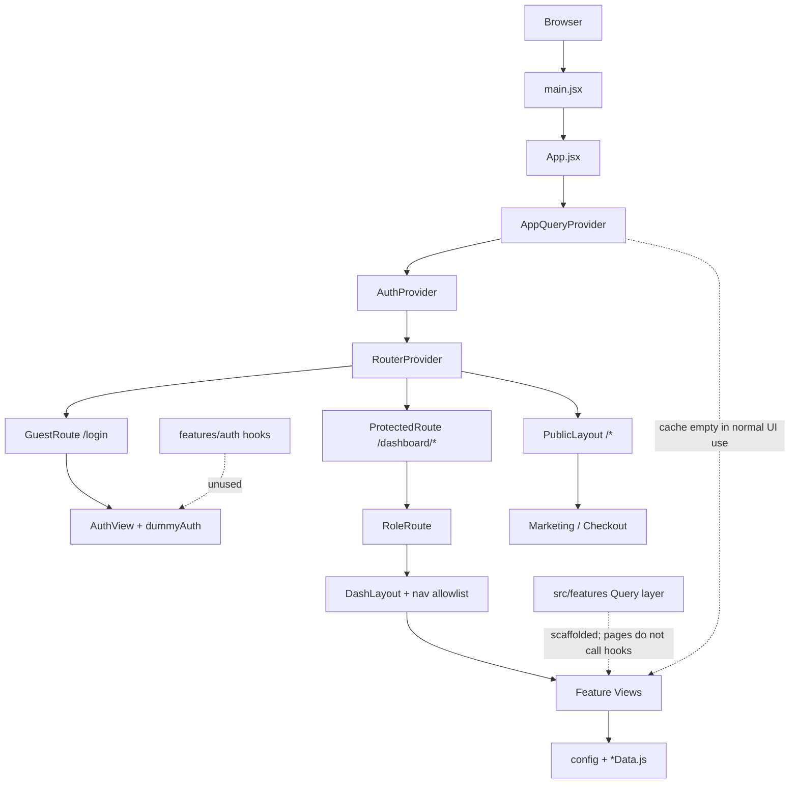

# Frontend E2E Analysis

**Product:** NovaSky (telecom / eSIM portal + multi-role dashboards)  
**Repository:** `diams` / package folder `web/`  
**Analysis date:** 2026-09-22 (fresh re-audit)  
**Scope:** Frontend only — investigation, no application source changes  
**Evidence basis:** Current source inspection of `package.json`, `src/**`, configs, `README.md`, `src/features/README.md`, `doc/BACKEND_INTEGRATION.md`  
**Previous baseline:** Earlier `FRONTEND_E2E_ANALYSIS.md` (same date cycle) — treated as historical only; every finding re-verified

**Evidence legend:** **Confirmed** = observed in code · **Inferred** = strong structural evidence · **Unknown / Not Verified** = not knowable from this repo alone

---

## 1. Executive Summary

NovaSky is a **Vite 7 + React 19 JavaScript SPA** with a polished public marketing/checkout surface and three role dashboards (admin, collaborator, user). Since the prior audit, the codebase has undergone a **substantial structural refactor**: modular `src/routes/`, infrastructure under `src/lib/`, and a full **feature-based TanStack Query scaffold** (~33 domains, ~195 files under `src/features/`).

**What is true right now:**

1. **UI data is still mock/local.** Pages consume `@/config/*` and co-located `*Data.js` + `useState`. Feature query/mutation hooks are **not imported by pages** (only 3 Zod schemas are).
2. **Auth is still demo-only** (`AuthContext` + `DUMMY_USERS` + `localStorage` key `novasky_auth`). Parallel `features/auth` login/me/logout hooks exist but are unused.
3. **Route-level code splitting is now real** (`React.lazy` + `withSuspense` across auth/public/dashboard routes) — previous “no lazy loading” finding is **fixed**.
4. **Several prior functional bugs remain:** broken public footer/CTA links (`/esim`, `/about`, `/careers`, `/press`, `/partners`); `DashLayout` nav allowlist blocks registered user notifications + collaborator identity/plans/support; checkout **Review** step still missing; payment UI still decorative.
5. **No automated tests.** No TypeScript application source. No ErrorBoundary / router `errorElement`.

**Highest-impact realities for shipping:**

| Priority | Reality |
|----------|---------|
| Critical (if treated as production) | Demo auth forgeable via localStorage; payment is not a PSP |
| High | Features scaffold unused → dual mock sources will drift; broken/blocked navigation |
| Medium | Modal a11y gaps; dual form stacks; unused deps |

**Production readiness (frontend alone):** **Early production / UI-complete prototype** — visually and navigationally rich, not production-capable for live auth, payments, or server-backed CRUD without wiring and security replacement.

---

## 2. Project Overview

| Item | Value | Confidence |
|------|-------|------------|
| App name (package) | `basic` (`package.json`) | Confirmed |
| Product branding | NovaSky | Confirmed |
| Module type | ES modules (`"type": "module"`) | Confirmed |
| Entry HTML | `index.html` → `/src/main.jsx` | Confirmed |
| App shell | `src/App.jsx` (providers + router) | Confirmed |
| Source language | JavaScript + JSX only (0 `.ts`/`.tsx`) | Confirmed |
| Approx. size | ~356 `.jsx` + ~294 `.js` under `src/` (~650 total) | Confirmed |
| Feature modules | ~195 files under `src/features/` | Confirmed |
| Config content | 36 files in `src/config/` | Confirmed |
| Page mock data | 21 `*Data.js` under `pages/dashboard/**` | Confirmed |
| Shared components | 36 files under `src/Components/` | Confirmed |
| Docs | `README.md`, `doc/BACKEND_INTEGRATION.md`, `src/features/README.md`, this file | Confirmed |
| Live demo (README) | https://nova-sky.maktechgroup.tech/ | Confirmed (URL claim); live parity **Unknown** |

**Character:** Marketing + checkout funnel + dense multi-role dashboards as **UI prototypes with local mock data**, plus a **ready-but-unwired** Axios/TanStack Query feature layer and a mock toggle (`VITE_USE_API_MOCKS`, default **on**).

---

## 3. Technology Stack

### Confirmed stack (used in code)

| Concern | Technology | Version | Evidence |
|---------|------------|---------|----------|
| UI | React / React DOM | ^19.2.0 | `main.jsx`, `App.jsx` |
| Build | Vite | ^7.2.4 | `vite.config.js`, scripts |
| CSS | Tailwind CSS v4 + `@tailwindcss/vite` | ^4.1.18 | `index.css` `@import "tailwindcss"`, `@theme` |
| Routing | React Router | ^7.18.2 | `createBrowserRouter` in `src/routes/index.js` |
| HTTP | Axios | ^1.20.0 | `src/lib/api/client.js` |
| Server state | TanStack React Query | ^5.102.8 | `AppQueryProvider`, `features/**/queries` |
| Query Devtools | `@tanstack/react-query-devtools` | ^5.103.2 | DEV-only lazy load in provider |
| Forms | react-hook-form | ^7.88.0 | 5 form screens |
| Validation | Zod + `@hookform/resolvers` | ^4.6.5 / ^5.9.1 | `lib/validation`, feature schemas |
| Charts | Recharts | ^3.10.1 | Admin/collaborator overview charts |
| Icons | lucide-react | ^0.562.0 | Widespread |
| Icons (limited) | react-icons | ^5.7.0 | Auth Google, Footer, one help card |

### Declared but unused / weakly used

| Dependency | Status | Evidence |
|------------|--------|----------|
| `chart.js` + `react-chartjs-2` | **Unused** | No imports under `src/` |
| `lucide` (non-React) | **Unused** | Only `lucide-react` imported |
| `lenis` | **Installed; SmoothScroll unused** | `Components/common/SmoothScroll.jsx` exists; never imported |
| Framer Motion | **Not in package.json** | README no longer claims it (fixed vs older docs) |

### Not present

| Concern | Finding |
|---------|---------|
| Redux / Zustand / Jotai | Not used |
| TypeScript app source | No `.ts`/`.tsx`; `jsconfig.json` for `@/*` only |
| i18n library | English copy in config/JSX |
| Testing runners | No Vitest/Jest/Cypress/Playwright; no `*.test.*` |
| PropTypes | None |
| Prettier | No config |
| UI kit (MUI/Chakra/shadcn) | Custom Tailwind |
| `src/services/`, `src/schemas/`, `src/api/`, `src/layout/` | Absent — roles covered by `lib/`, `features/*/validation`, `lib/api`, `Components/layout` |

### Role of major dependencies

- **React 19 + Vite 7:** SPA bootstrap and HMR/build.
- **Tailwind v4:** Design tokens in `@theme`.
- **React Router 7:** Nested public / guest / protected / role routes with lazy page modules.
- **Axios + ENDPOINTS + feature `*.api.js`:** Prepared for backend; mock branch default-on.
- **TanStack Query:** Provider + defaults + full feature hooks; **UI does not call hooks yet**.
- **RHF + Zod:** Partial adoption (login, tickets, password change, collaborator account settings).
- **Recharts:** Dashboard analytics from mock series.

---

## 4. Project Structure

```text
web/
├── index.html
├── package.json / package-lock.json
├── vite.config.js              # React + Tailwind; alias @ → ./src
├── jsconfig.json               # paths @/*
├── eslint.config.js
├── .env / .env.example         # VITE_API_BASE_URL, VITE_USE_API_MOCKS
├── README.md
├── doc/
│   ├── BACKEND_INTEGRATION.md
│   ├── FRONTEND_E2E_ANALYSIS.md   ← this file
│   └── FRONTEND_ENGINEERING_SCORECARD.md
├── public/                     # logo.png, bag/gb/plane/sim*.png
└── src/
    ├── main.jsx                # StrictMode → App
    ├── App.jsx                 # Query + Auth + RouterProvider
    ├── index.css / App.css     # App.css empty/orphan
    ├── assets/
    ├── Components/             # common, dashboard, form, layout, navigation, public
    ├── config/                 # UI copy, nav, dummyAuth
    ├── context/AuthContext.jsx
    ├── features/               # auth | public | dash/{admin,collaborator,user}
    ├── hooks/index.js          # re-exports useAuth only
    ├── lib/
    │   ├── api/                # client, endpoints, interceptors, mock
    │   ├── auth/session.js
    │   ├── config/env.js
    │   ├── provider/           # AppQueryProvider, query-client
    │   ├── storage/
    │   ├── validation/
    │   └── utility/            # EMPTY
    ├── pages/                  # auth, public, dashboard, error
    └── routes/                 # paths, helpers, guards, route modules
```

**Alias:** `@` → `./src` (`vite.config.js`, `jsconfig.json`).  
**Package manager:** npm (`package-lock.json`).  
**Scripts:** `dev`, `build`, `lint`, `preview` — **no `test`**.

---

## 5. Architecture

### Real architecture (as implemented)

```text
Browser
  └── index.html
        └── main.jsx
              └── App.jsx
                    ├── AppQueryProvider (QueryClient + DEV Devtools)
                    └── AuthProvider
                          └── RouterProvider (src/routes)
                                ├── GuestRoute → /login (AuthView) ← dummy AuthContext
                                ├── ProtectedRoute
                                │     ├── /dashboard → RoleDashboardRedirect
                                │     ├── RoleRoute(admin) → DashLayout(allowlist) → Admin pages
                                │     ├── RoleRoute(collaborator) → DashLayout → Collaborator pages
                                │     └── RoleRoute(user) → DashLayout → User pages
                                └── PublicLayout
                                      └── Marketing + checkout + legal + NotFound (*)
```

**Intended data flow (documented, mostly unused by UI):**

```text
Page → features/*/queries → features/*/api → (USE_API_MOCKS ? mocks : apiClient + ENDPOINTS)
```

**Actual data flow (Confirmed):**

```text
Page → @/config/* | *Data.js | useState
Page → features/*/validation (3 schemas only)
Auth UI → AuthContext → DUMMY_USERS → localStorage
```

### Mermaid — bootstrap & data reality



### Separation of concerns evaluation

| Layer | Intended home | Actual practice | Assessment |
|-------|---------------|-----------------|------------|
| UI | `pages/`, `Components/` | Yes | Good |
| Domain server state | `features/` | Scaffold only | **Gap** |
| Session/auth UI | `context/AuthContext` | Yes (dummy) | OK for demo |
| HTTP / env | `lib/api`, `lib/config` | Yes | Good |
| Validation | `lib/validation` + feature schemas | Partial | Mixed |
| Copy / nav | `config/` | Yes | Good for marketing |
| Utilities | `lib/utility/` | Empty | Placeholder |

**Recommendation:** Do **not** invent new layers. Prefer incremental migration of pages onto existing feature hooks. Dual mock sources (`features/*/mocks` vs `*Data.js`) should converge, not proliferate.

---

## 6. Routing Audit

### Composition

`src/routes/index.js` → `createBrowserRouter([...authRoutes, ...dashboardRoutes, ...publicRoutes])`.

Helpers: `withSuspense`, `createRoleDashboardRoutes`, `detailRoutes` in `src/routes/helpers.jsx`.  
Path constants: `src/routes/paths.js` (`ROUTES`, `absolute()`).

### Complete route tree

```text
/
├── /login                          GuestRoute → AuthView (lazy)
├── /dashboard                      ProtectedRoute → RoleDashboardRedirect
├── /dashboard/admin/**             Protected + Role(admin) + DashLayout
│   ├── (index) Overview
│   ├── customer, customer/:id
│   ├── orders, orders/:id
│   ├── identity, identity/:id
│   ├── plans, plans/create, plans/edit/:id, plans/:id
│   ├── add-ons, add-ons/create, add-ons/edit/:id
│   ├── esim, esim/:id
│   ├── billing
│   ├── support, support/:id
│   ├── notifications
│   ├── reports
│   ├── users
│   ├── settings
│   └── audit-logs
├── /dashboard/collaborator/**      Protected + Role(collaborator) + DashLayout
│   ├── (index) Overview
│   ├── customers, customers/:id    (:id may be "register")
│   ├── orders, orders/:id
│   ├── activations, activations/:id
│   ├── commissions
│   ├── invoices
│   ├── notifications
│   ├── profile
│   ├── identity                    ⚠ registered; allowlist BLOCKS
│   ├── plans                       ⚠ registered; allowlist BLOCKS
│   └── support                     ⚠ registered; allowlist BLOCKS
├── /dashboard/user/**              Protected + Role(user) + DashLayout
│   ├── (index) Overview
│   ├── my-line, plans-options, usage, bills, payments, esim
│   ├── my-information, security, support
│   └── notifications               ⚠ registered + Header link; allowlist BLOCKS
└── PublicLayout (no auth guard)
    ├── /
    ├── /plans, /plans/:planId
    ├── /plans/:planId/configure → personal-info → verification → payment
    │                              → confirmation → activation
    ├── /business, /coverage, /help, /account
    ├── /legal, /privacy, /terms
    └── * → NotFound
```

### Guards (Confirmed — real route guards, not UI-only)

| Guard | Behavior | File |
|-------|----------|------|
| `ProtectedRoute` | Unauthed → `/login` + `state.from` | `routes/guard/ProtectedRoute.jsx` |
| `GuestRoute` | Authed → role dashboard | same |
| `RoleRoute` | Wrong role → own role home | same |
| `DashLayout` allowlist | Path must match `DASHBOARD_NAV` prefix or redirect home | `Components/layout/DashLayout.jsx` L37–47 |

**Security note:** These are **UX / client navigation restrictions**, not a security boundary. Any user can forge `novasky_auth` in localStorage. Server must enforce RBAC.

### Lazy loading / Suspense

**Confirmed fixed vs prior audit:** all major page modules use `lazy()` + `RouteFallback` via `withSuspense`.

### Missing public targets (links → NotFound)

| Link source | Path | Route? |
|-------------|------|--------|
| `config/footer.js`, hero/features CTAs | `/esim` | **No** |
| `config/footer.js` | `/about`, `/careers`, `/press`, `/partners` | **No** |

### Redirect behavior

| Trigger | Destination |
|---------|-------------|
| Unauthed dashboard | `/login` + `from` |
| Login success | Role dashboard — **`from` ignored** (`AuthFormSection`) |
| Authed `/login` | Role dashboard |
| Wrong role tree | Own role dashboard |
| Path not in nav allowlist | Role dashboard |
| Logout | `/login` replace |
| Bad `planId` in checkout | `/plans` |
| Unknown URL | `NotFound` under PublicLayout |

---

## 7. Feature Architecture Audit

Conventions: `src/features/README.md`. Layout: `api/` · `mocks/` · `queries/{keys,queries,mutations}` · optional `validation/` · `index.js`.

### Feature map

| Audience | Features | Pages use query hooks? |
|----------|----------|------------------------|
| `auth/` | login, me, logout + `loginSchema` | **No** hooks; schema **yes** |
| `public/plans`, `public/addOns` | catalog + mutations | **No** — UI uses `@/config/plans` etc. |
| `dash/admin/*` (13) | customers, orders, identity, plans, addOns, esim, billing, support, notifications, users, reports, settings, auditLogs | **No** — `*Data.js` |
| `dash/collaborator/*` (10) | customers, orders, activations, commissions, invoices, notifications, profile, identity, plans, support | **No** hooks; `accountSettingsSchema` **yes** |
| `dash/user/*` (7) | overview, usage, bills, payments, esim, support, notifications | **No** hooks; `newTicketSchema` **yes** |

**Gaps vs pages:** no feature modules for admin/collaborator **overview**, user **plans-options**, user **security**. Those remain page/config-only.

### Coupling / duplication

- **Dual mock sources:** thin `features/*/mocks` vs rich page `*Data.js` / `@/config/user*` — **Confirmed drift risk**.
- **Dual auth:** `AuthContext` vs unused `features/auth` hooks.
- **Barrel name collision risk:** public and admin both export names like `planKeys` / `usePlans` — safe if imported from concrete paths; risky if star-importing both.
- **Collaborator live endpoints (when mocks off):** some APIs reuse global/admin-style `ENDPOINTS` — **Inferred** scoping concern for real backend.

### Scalability assessment

| Dimension | Verdict |
|-----------|---------|
| Folder cohesion | **Strong** — audience → role → domain |
| Maintainability today | **Moderate** — scaffold good; dual data hurts |
| Appropriateness | **Appropriate** — do not add more layers; wire existing ones |

---

## 8. `lib/`, `utils/`, `services/`, `hooks/` Audit

| Folder | Exists? | Contents / verdict |
|--------|---------|-------------------|
| `lib/api` | Yes | Axios client, interceptors, ENDPOINTS, mock helpers — **correct home** |
| `lib/provider` | Yes | QueryClient defaults + provider — **correct** |
| `lib/auth` | Yes | Session read/clear/token helpers — **correct** |
| `lib/storage` | Yes | localStorage wrappers — **correct** |
| `lib/config` | Yes | `env.js` — **correct** |
| `lib/validation` | Yes | Shared Zod primitives + change-password + zodResolver re-export — **correct** |
| `lib/utility` | Yes but **empty** | Placeholder; no misplaced utils found dumping here |
| `hooks/` | Stub only | Re-exports `useAuth`; comments defer query hooks to features — **OK** |
| `services/` | **No** | Feature `api/` fulfills this role — no need to invent |
| `utils/` | **No** | Formatting mostly inline / config — acceptable at current scale |

**Misplacements:** Business/server logic still living in page `useState` + `*Data.js` rather than features — architectural debt, not wrong folder names.

---

## 9. Query / Server-State Architecture

### QueryClient defaults (`lib/provider/query-client.js`)

| Option | Value |
|--------|-------|
| `staleTime` | 60_000 |
| `gcTime` | 5 × 60_000 |
| `refetchOnWindowFocus` | false |
| query `retry` | < 2; skip 401/403/404 |
| mutation `retry` | 0 |

### Strengths (Confirmed)

- Hierarchical key factories with role prefixes (`["dash","admin",…]`, etc.).
- `queryFn` forwards AbortSignal.
- Detail queries use `enabled: !!id`.
- Mutations invalidate via `onSettled`.
- Logout calls `queryClient.clear()` (`AuthContext.jsx`).
- Mock switch: `USE_API_MOCKS` from `env.useApiMocks`.

### Weaknesses (Confirmed)

- **Zero page consumption** of `useQuery` / `useMutation` from features.
- No optimistic updates / `setQueryData` usage observed.
- Server-shaped data duplicated into local React state (tickets, payments, esim, profile edits, admin CRUD).
- No shared ApiStateGate / query error UI component (prior helper **removed/absent**).
- Cache correctness in production UI is **Not Verified** because cache is unused.

### Evaluation

| Criterion | Score note |
|-----------|------------|
| Separation of Concerns | Scaffold excellent; runtime SoC poor |
| Consistency | Strong within `features/` |
| Cache / invalidation correctness | Correct patterns; unused |
| Reusability / scalability | High potential |
| Error handling | Provider-level only; UI absent |
| Performance | Defaults sane; unused |

---

## 10. Authentication & Authorization Audit

### Lifecycle (actual)

```text
Login (AuthFormSection)
  → AuthContext.login(email, password)
  → match DUMMY_USERS
  → setUser + setJSON("novasky_auth", { email, name, role })   ← NO token
  → navigate(role dashboard)   ← ignores location.state.from
  → ProtectedRoute / RoleRoute / DashLayout
Logout (Sidebar)
  → AuthContext.logout → clearAuthSession + queryClient.clear → /login
```

### Parallel unused path

`features/auth` (`useLogin`, `useMe`, `useLogout`, mock with `demo-access-token`) — **not wired** to AuthView.

### Token / API

| Concern | Status | Evidence |
|---------|--------|----------|
| Token on login | Not written | `AuthContext` session shape |
| `getAccessToken` | Reads `token` \|\| `accessToken` | `lib/auth/session.js` |
| Request interceptor | Bearer if present | `lib/api/interceptors.js` |
| 401 handling | **No-op stub** | same file comment |
| `rememberMe` | UI-only | `AuthFormSection` |
| sessionStorage | Unused | repo grep |
| Demo passwords in UI | Displayed | `AuthFormSection` demo buttons |

### Authorization

| Mechanism | Type |
|-----------|------|
| Route guards | **UX restriction** (client) |
| Nav allowlist | **UX restriction** (can over-block) |
| API RBAC | **Not enforced** by frontend demo path; backend **Not Verified** |

---

## 11. Form & Validation Audit

### RHF + Zod (5 screens)

| Screen | Schema location |
|--------|-----------------|
| Login | `features/auth/validation/login.schema.js` |
| New ticket | `features/dash/user/support/validation/ticket.schema.js` |
| Change password (security + collaborator) | `lib/validation/change-password.schema.js` |
| Collaborator account settings | `features/dash/collaborator/profile/validation/...` |

Shared: `lib/validation/common.schemas.js`, `FieldError` component.

### Manual / uncontrolled (~26+ forms)

Checkout funnel forms, most admin/collaborator modals, many user modals (including a **second** my-information `ChangePasswordModal` with ad-hoc length checks).

### Assessment

- Shared validation architecture is **appropriately split** (common primitives + feature schemas) — not a giant central dump.
- Adoption is **too thin** for checkout/payment and most CRUD modals.
- Duplicate password UX is a consistency bug.

---

## 12. Component Architecture

### Shared (`src/Components/`)

| Area | Examples |
|------|----------|
| Layout | `PublicLayout`, `DashLayout` |
| Navigation | Navbar, Footer, dashboard Header/Sidebar |
| Dashboard | `DataTable`, `DashboardPageShell`, Tabs, Widgets, `UpcomingPage` |
| Public | Checkout widgets (stepper, payment method, PCI banner, etc.) |
| Form | `FieldError` |
| Common | `RouteFallback`, `ScrollToTop`, unused `SmoothScroll` |

### Pages

- Generally **orchestration + section composition** with heavy section files.
- Many pages **seed local state from Data/config** — business/data logic in UI layer.
- Large files (**Confirmed**): `DataTable.jsx` (~597), `CreateAddonView` (~580), `CreatePlanView` (~474), `MakePaymentTab` (~441).

### Assessment

Feature-specific UI correctly lives under `pages/dashboard/...`. Shared primitives are useful. Main problem is **data ownership**, not component placement.

---

## 13. State Management Audit

| Mechanism | Used? | Classification |
|-----------|-------|----------------|
| React `useState`/`useMemo` | Yes | UI + **incorrectly held server data** |
| Context (`AuthContext`) | Yes | Session/auth UI state |
| TanStack Query | Mounted; unused by pages | Intended server state |
| URL / route params | Yes (`planId`, `:id`) | URL state |
| localStorage | Auth session, sidebar collapse | Persistent client |
| sessionStorage | No | — |
| Redux / RTK | No | — |
| Cookies | No client cookie auth | — |

**Problems:** server data in `useState`; derived filters often correctly memoized; auth hydration on boot via `readStoredUser`.

---

## 14. API Layer Audit

```text
(Intended) Component → feature hook → feature api → apiClient → backend
(Actual)   Component → config/*Data.js
```

| Piece | Path | Notes |
|-------|------|-------|
| Client | `lib/api/client.js` | baseURL, 30s timeout, JSON |
| Interceptors | `lib/api/interceptors.js` | Bearer; 401 stub |
| Endpoints | `lib/api/endpoints.js` | Central map |
| Mock helpers | `lib/api/mock.js` | delay, filters, findById |
| Env | `lib/config/env.js` | `VITE_API_BASE_URL`, `VITE_USE_API_MOCKS` |

**No raw `fetch(` in `src/`** (Confirmed). Feature APIs use `apiClient` when mocks off.  
**Direct bypass of architecture:** pages never enter the intended chain.

---

## 15. Error / Loading / Empty State Audit

> **Remediation status (2026-09-22):** Infrastructure and major API-driven pages were wired after this audit. See implementation notes at the end of this section. Historical findings below remain as the baseline that drove the work.

**Verdict (Confirmed at audit time):** Route-level Suspense and table **empty** copy were solid. Almost every journey was still **static/mock UI**, so HTTP errors, refetch, retry, query loading, and mutation failure UX were **infrastructure-only**. That gap has been substantially closed for list/CRUD screens (see §15.7).

Legend for this section: **Confirmed** · **Inferred** · **Not Verified** · ✅ handled · ⚠️ partial · ❌ missing · — N/A

---

### 15.1 Cross-cutting primitives

| Primitive | Status (post-fix) | Evidence |
|-----------|-------------------|----------|
| **Route Suspense fallback** | ✅ Consistent | `Components/common/RouteFallback.jsx`; `withSuspense` in `routes/helpers.jsx` |
| **App ErrorBoundary** | ✅ Added | `Components/common/AppErrorBoundary.jsx` wraps app in `App.jsx` |
| **Router `errorElement`** | ✅ Added | `routes/index.js` + `Components/common/RouteErrorPage.jsx` |
| **Toast / snackbar** | ✅ Minimal bus + host | `lib/feedback/toast-bus.js`, `Components/common/ToastProvider.jsx` |
| **ErrorState / EmptyState / QueryStatus** | ✅ Shared | `Components/common/{ErrorState,EmptyState,QueryStatus}.jsx` |
| **FieldError** | ✅ Local form | `Components/form/FieldError.jsx` |
| **DataTable loading / error / retry / refetch** | ✅ Consumed | Props `isLoading`, `isFetching`, `error`, `onRetry` wired from feature queries on major list pages |
| **Axios error handling** | ✅ Normalized | `lib/api/errors.js`; interceptor handles 401 logout, 403/429 toasts (`lib/api/interceptors.js`) |
| **Query retry defaults** | ✅ Still in QueryClient | `lib/provider/query-client.js` |
| **Mutation feedback hook** | ✅ Added | `hooks/useMutationFeedback.js` |

---

### 15.2 Status-code / failure checklist (post-fix)

| Concern | Product UX today | Classification |
|---------|------------------|----------------|
| **Initial loading (code-split)** | RouteFallback | Confirmed ✅ |
| **Initial loading (data)** | DataTable / QueryStatus on wired pages | Confirmed ✅ (major lists) |
| **Refetching / `isFetching`** | “Updating…” bar on DataTable | Confirmed ✅ |
| **Mutation loading** | `isPending` guards + disabled submits on wired mutations | Confirmed ✅ |
| **Network / 500** | ErrorState + Retry via normalizeApiError | Confirmed ✅ |
| **401 (API)** | Interceptor → logout + redirect `/login` | Confirmed ✅ |
| **401 / unauthenticated (route)** | `ProtectedRoute` | Confirmed ✅ |
| **403** | Toast “Access denied” | Confirmed ✅ |
| **404 (public URL)** | Branded `NotFound` | Confirmed ✅ |
| **404 (resource)** | Detail not-found panels / ErrorState | Confirmed ⚠️ (wired domains) |
| **422** | Field errors when API returns `errors`; RHF forms | Confirmed ⚠️ |
| **429** | Warning toast | Confirmed ✅ |
| **Empty state** | DataTable emptyMessage / EmptyState | Confirmed ✅ |
| **User-facing Retry** | ErrorState / DataTable onRetry → `refetch` | Confirmed ✅ |

---

### 15.3-15.6 (historical journey detail)

The detailed journey matrices from the pre-fix audit (public marketing static content, checkout Review gap, allowlist-blocked collaborator routes, unused feature hooks) are preserved in git history of this file. Post-fix, the **API-driven list/CRUD journeys** for admin, collaborator core tables, user support/payments/bills/esim/overview gate, and public plans now consume feature queries.

Checkout payment now validates card fields client-side with FieldError + toasts before navigating (still not a real PSP).

---

### 15.7 Implementation notes (remediation)

**What was added**
- Error normalization + interceptor status handling (`lib/api/errors.js`, `interceptors.js`)
- Unauthorized bridge (`lib/auth/unauthorized.js` + `App.jsx`)
- Toast bus/provider, ErrorBoundary, RouteErrorPage, ErrorState, EmptyState, QueryStatus
- DataTable error/retry/fetching UX
- `createMockStore` so mock mutations survive refetch
- Feature seeds + page wiring for admin lists, collaborator lists, user support/payments/bills/esim, public plans

**Remaining gaps**
- Admin plans/settings/reports/overview still largely config-driven (not all domains wired)
- Collaborator notifications/identity/plans/support still allowlist-blocked or unwired
- User eSIM rename/delete and some overview chrome still local/`@/config`
- Checkout Review step + funnel persistence still missing (out of Section 15 UX scope)
- Password-change mutations not fully API-wired
- Lint still reports pre-existing unused-var / set-state-in-effect issues unrelated to this pass

**Verification:** `npm run build` succeeds after remediation.

---

## 16. Performance Audit

| Item | Evidence-based finding |
|------|------------------------|
| Route code splitting | **Fixed** — lazy routes throughout |
| Unused deps | chart.js, lucide, lenis inflate install/bundle potential |
| SmoothScroll | Dead code path |
| Images | Plain ``; little/no `loading="lazy"` on heroes |
| React.memo | Not used; selective `useMemo`/`useCallback` |
| Query waterfalls | N/A in UI (no queries) |
| Large view files | Editability cost more than proven runtime cost |

Do **not** claim micro-render issues without profiling — **Not Verified**.

---

## 17. Accessibility Audit

| Issue | Status | Evidence |
|-------|--------|----------|
| Modal dialog roles / focus trap / Escape | **Confirmed issue** | ~45 modals: overlay panels without `role="dialog"` / `aria-modal` / trap |
| Label association | Mixed | Payment labels good; many modals lack `htmlFor`/`id` |
| Navbar mobile toggle | Better | `aria-label` / `aria-expanded` |
| DataTable row actions | Partial | `aria-label`; focus return **Not Verified** |
| div-as-button | Potential | Some `role="button"` patterns; upload dropzones as non-interactive divs |
| Color contrast | **Not Verified** | Needs visual QA |
| Heading hierarchy | **Not Verified** site-wide | |

---

## 18. Responsive / UX Audit

| Area | Finding |
|------|---------|
| Public Navbar | Mobile hamburger + slide menu (`lg:`) |
| Dashboard Sidebar | Off-canvas mobile; collapsible desktop; preference persisted |
| DataTable | Mobile card layout + desktop `overflow-x-auto` |
| Checkout | Stacked → sidebar grid on large screens |
| Broken CTAs / blocked routes | Harm UX predictability |
| Checkout Review skip | Stepper shows Review; flow skips it |

---

## 19. Security Audit

| Topic | Finding | Boundary type |
|-------|---------|---------------|
| XSS via `dangerouslySetInnerHTML` | **None found** | — |
| Auth storage | localStorage role session; ready for JWT fields | **UX only** today; JWT-in-LS = future XSS theft risk |
| Client RBAC | Guards + allowlist | **UX restriction**, not security |
| Open redirect | `from` saved but unused on login; checkout uses fixed paths | Low risk today |
| Env | Only `VITE_*` public vars | Expected |
| Demo passwords in UI | Confirmed | Demo hygiene |
| Payment card fields | Uncontrolled DOM inputs; Link to confirmation | **Demo only** — must not be productionized as-is |
| PCI banner copy | Present (`PciSecurityBanner`) | Marketing; not a control |
| Source maps / prod hardening | **Not Verified** from source alone |
| Backend authorization | **Not Verified** | Must not be assumed |

**Explicit:** Frontend cannot enforce backend authorization. Treat all dashboard “permissions” as presentation.

---

## 20. Type Safety

| Topic | Finding |
|-------|---------|
| Language | JS/JSX only |
| `@types/react*` | Present as deps; no TS source |
| Zod | Minority of forms |
| API response typing | None at boundary |
| PropTypes | None |

Not penalized for choosing JS; risk rises when live APIs land without parsers/contracts.

---

## 21. Testing Audit

| Check | Result |
|-------|--------|
| Unit / component / integration / E2E files | **0** |
| Test scripts / runners | **None** |
| CI test execution | **Not Verified** / no frontend test config found |

Critical journeys (auth, guards, checkout, CRUD) have **no automated coverage**.

---

## 22. Dependency Audit

| Package | Verdict |
|---------|---------|
| chart.js, react-chartjs-2 | Unused — remove candidate |
| lucide | Unused — remove candidate |
| lenis | Only via unused SmoothScroll — remove or wire |
| recharts | Used |
| lucide-react, react-icons | Used (overlap acceptable at light react-icons use) |
| @types/react* | Optional for JS IDE; harmless |

Do not remove until import absence re-confirmed at change time (already verified in this audit).

---

## 23. Dead Code / Duplication Audit

| Item | Status |
|------|--------|
| `SmoothScroll.jsx` + lenis | **Confirmed** dead path |
| `App.css` | Empty, unused |
| `features/**` query hooks | **Suspected unfinished scaffold** (intentional future use) — not “delete,” but unused |
| Dual auth / dual mocks / dual password modals | **Confirmed** duplication |
| TODO/FIXME in `src` | **0** |
| Collaborator identity/plans/support pages | Reachable only if allowlist fixed — currently blocked |

---

## 24. Developer Experience

| Area | Assessment |
|------|------------|
| Folder discoverability | Good after refactor (`features`, `lib`, `routes`) |
| Naming | Mostly consistent; `Components` capital-C legacy |
| Lint | ESLint flat config present |
| Format | No Prettier |
| Typecheck | N/A |
| Env setup | Clear `.env.example` + README |
| README | Largely accurate; still lists Chart.js in stack table |
| `BACKEND_INTEGRATION.md` | May describe older `src/api/` layout — **Inferred drift** |
| Onboarding | Demo accounts easy; dual data layers confuse “which source of truth?” |
| package name `basic` | Cosmetic debt |

---

## 25. End-to-End User Journeys

### Journey A — Public browse → checkout → confirmation

```text
PlansView → PlanDetailsView → ConfigureView → PersonalInfoView
  → VerificationView → PaymentView → ConfirmationView → (optional) ActivationView
```

| Aspect | Status |
|--------|--------|
| Happy path navigation | Works as page carousel |
| Loading | Suspense on route chunks |
| Persistence | **None** across refresh |
| Review step | **Skipped** (CHECKOUT_STEPS id 5 unused) |
| Payment | Decorative inputs + Link |
| Authorization | Public (open) |
| Broken entry CTAs | `/esim` from home/footer |

### Journey B — Login admin → overview

```text
/login → AuthContext dummy → /dashboard/admin → AdminOverview (overviewData.js)
```

Guards enforce role. Data static. Feature admin hooks unused.

### Journey C — User support ticket

```text
/dashboard/user/support → NewTicketModal (RHF+Zod) → prepend local tickets state
```

No feature support API call. Notifications page linked from Header but **allowlist-blocked**.

### Journey D — Collaborator customers

```text
/dashboard/collaborator/customers → local collaboratorCustomerData → filters/detail/register
```

identity/plans/support routes exist but redirect home via allowlist.

### Journey E — Logout

```text
Sidebar → logout() → clear storage + queryClient.clear → /login
```

Works for demo session cleanup.

---

## 26. Previous Audit Reconciliation

| Previous Finding | Current Status | Evidence |
|------------------|----------------|----------|
| Demo/forgeable auth (`AuthContext` + `dummyAuth`) | **Still Valid** | `AuthContext.jsx`, `dummyAuth.js` |
| Payment UI not real PSP / decorative card fields | **Still Valid** | `PaymentFormSection.jsx` |
| Broken public links `/esim`, `/about`, `/careers`, `/press`, `/partners` | **Still Valid** | `footer.js`, routes lack paths |
| Allowlist blocks collaborator identity/plans/support + user notifications | **Still Valid** | `dashboard.js` vs route modules + `DashLayout.jsx` |
| Checkout Review missing; stepper inconsistency | **Still Valid** | `configure.js` CHECKOUT_STEPS vs payment→confirmation |
| No shared checkout state persistence | **Still Valid** | Checkout views local/uncontrolled |
| API/Query unused by pages | **Still Valid** (scaffold expanded) | features exist; pages don't import hooks |
| No automated tests | **Still Valid** | No test files/scripts |
| Modal a11y gaps | **Still Valid** | Modal pattern without dialog semantics |
| Dual form stacks (RHF vs raw) | **Still Valid** | 5 RHF vs many manual |
| Unused chart.js / lucide / Lenis mount | **Still Valid** | package.json + import grep |
| `rememberMe` noop | **Still Valid** | `AuthFormSection` |
| Login ignores `state.from` | **Still Valid** | `AuthFormSection` navigate |
| 401 interceptor unfinished | **Still Valid** | `interceptors.js` stub |
| No route lazy-loading / code splitting | **Fixed** | `lazy()` in all route modules |
| Providers only in `main.jsx` / no `App.jsx` | **Fixed / Obsolete** | `App.jsx` owns providers |
| API under `src/api/`, router under `src/router/` | **Obsolete** | Now `lib/api`, `routes/` |
| `formSchemas.js` monolithic | **Partially Fixed** | Split to `lib/validation` + feature schemas; coverage still thin |
| `ApiStateGate` ready for views | **Obsolete** | Component absent; need new shared pattern when wiring |
| README claims Framer Motion / wrong tree | **Partially Fixed** | README mostly matches; Chart.js still listed |
| Static route imports → bundle growth | **Fixed** | Lazy routes |
| Features / query key factories incomplete | **Partially Fixed** | Full feature map scaffolded; still unwired to UI |
| SmoothScroll / App.css leftovers | **Still Valid** | Dead paths remain |
| Console.log stubs | **Still Valid** | Admin support/add-ons areas |
| Duplicate NeedHelpCard naming | **Unknown** | Not re-traced this pass — treat as low if still present |

---

## 27. Engineering Scorecard

Scores are from **current evidence**, not carried forward for consistency.

| Category | Score | Rationale | Strengths | Weaknesses | Toward 9–10 |
|----------|------:|-----------|-----------|------------|-------------|
| Project Structure | 7.5/10 | Clear features/lib/routes/pages | Documented conventions | Dual data homes; empty utility; package name | Single data ownership story |
| Architecture | 6.5/10 | Intended architecture solid | Audience foldering | Pages bypass features; dual auth | Wire pages to features |
| Readability | 7/10 | Consistent feature naming | Route helpers | Very large view files | Split god views |
| Maintainability | 5.5/10 | Scaffold helps future | — | Dual mocks drift | Delete page Data as features adopt |
| Scalability | 6/10 | Feature map scales | Key namespaces | Unwired surface area large | Incremental migration plan |
| Code Quality | 5.5/10 | Guards, Suspense | — | Nav/link/stepper bugs; dual forms | Fix allowlist + links + forms |
| Reusability | 6.5/10 | DataTable, layouts, feature hooks | — | Hooks unused | Consume shared hooks |
| Separation of Concerns | 5.5/10 | Documented SoC | lib vs features | UI owns server data | Enforce page→hook rule |
| State Management | 5/10 | Auth context OK | Query defaults | Server state in useState | Migrate to Query |
| API Architecture | 7/10 | Client/endpoints/mocks coherent | Env mock flag | Unused by UI; 401 stub | Wire + complete 401 |
| Query Architecture | 6.5/10 | Excellent unused scaffold | Keys, invalidation, signal | Zero page usage | Adopt in screens |
| Error Handling | 4/10 | RouteFallback only | DataTable empty | No error boundaries; console stubs | Shared query error UI + boundaries |
| Security | 3.5/10 | No XSS sinks found | Demo labeled in places | Forgeable session; decorative payment | Real auth + PSP; never ship demo as prod |
| Performance | 6.5/10 | Lazy routes | — | Dead deps; image lazy weak | Trim deps; lazy images |
| Type Safety | 3/10 | Partial Zod | — | JS-only API boundary | Zod parse at API or gradual TS |
| Testing | 1/10 | — | — | Zero tests | Vitest + Playwright smoke |
| UI/UX | 6.5/10 | Polished marketing/dash | Responsive chrome | Broken/blocked nav; checkout gaps | Fix funnel + links |
| Accessibility | 4.5/10 | Some aria on nav | — | Modals weak | Dialog primitive |
| Responsive Design | 7/10 | Mobile nav/sidebar/table | — | Tables still complex | Device QA |
| Developer Experience | 6.5/10 | Good READMEs | Env docs | Dual SoT confusion; no prettier/test | Align docs + remove dead deps |
| Documentation | 7/10 | README + features README | Honest “many screens still *Data.js*” note | BACKEND_INTEGRATION drift; Chart.js claim | Sync docs to paths |

**Overall (mean of 21 categories): 5.7 / 10**

---

## 28. Final Assessment

| Dimension | Rating | Notes |
|-----------|--------|-------|
| **Overall Engineering Score** | **5.7 / 10** | Structure improved; runtime integration lagging |
| **Production Readiness** | **Early production / UI prototype** | Not production-ready for live auth, payments, or CRUD |
| **Technical Debt** | **High** | Dual data/auth, unreachable routes, unused scaffold, no tests |
| **Engineering Maturity** | **Emerging** | Conventions documented; enforcement incomplete |
| **Architecture Maturity** | **Scaffold-mature / integration-immature** | Right folders; wrong runtime wiring |

**Factual descriptors:** The frontend is **production-capable as a demo/marketing shell**, not **production-ready** as a live telecom operations product.

---

## 29. Priority Findings

### Critical

#### C1 — Demo auth must not be treated as production security
- **Problem:** Sessions are forgeable `{email,name,role}` in localStorage; passwords checked client-side.
- **Evidence:** `src/context/AuthContext.jsx`, `src/config/dummyAuth.js`
- **Impact:** Trivial privilege escalation if shipped as real auth.
- **Recommended direction:** Keep demo explicit; replace with real `/auth/login` + httpOnly cookies (preferred) or careful tokens + server RBAC; wire `features/auth`.
- **Affected files:** `AuthContext.jsx`, `dummyAuth.js`, `features/auth/**`, `lib/api/interceptors.js`
- **Priority:** Critical

#### C2 — Payment UI is not a payment integration
- **Problem:** Card fields are uncontrolled decorative inputs; CTA is a `Link` to confirmation.
- **Evidence:** `pages/public/payment/sections/PaymentFormSection.jsx`
- **Impact:** False order confirmation; PCI/compliance failure if treated as real.
- **Recommended direction:** Integrate hosted PSP fields; mark demo clearly; never POST PAN to own API.
- **Affected files:** `PaymentFormSection.jsx`, payment config/components
- **Priority:** Critical

### High

#### H1 — Broken public navigation targets
- **Problem:** Footer/hero/features link to routes that do not exist → NotFound.
- **Evidence:** `config/footer.js`, hero/features configs vs `public.routes.jsx`
- **Impact:** Dead CTAs on marketing surface.
- **Recommended direction:** Add pages or retarget links (`/plans`, `/help`, etc.).
- **Affected files:** `footer.js`, `hero.js`, `features.js`, `public.routes.jsx`
- **Priority:** High

#### H2 — Registered dashboard routes blocked by nav allowlist
- **Problem:** User notifications + collaborator identity/plans/support redirect to role home; Header still links to notifications.
- **Evidence:** `config/dashboard.js`, `DashLayout.jsx`, `Header.jsx`, collaborator/user route modules
- **Impact:** Broken in-app navigation; dead feature work.
- **Recommended direction:** Align `DASHBOARD_NAV` with routes or remove routes/features intentionally.
- **Affected files:** `dashboard.js`, `DashLayout.jsx`, related views
- **Priority:** High

#### H3 — Checkout Review step + no funnel persistence
- **Problem:** CHECKOUT_STEPS includes Review; payment jumps to confirmation; state not shared/persisted.
- **Evidence:** `config/configure.js`, checkout views, `PaymentFormSection` Link
- **Impact:** Misleading stepper; lost data on refresh; skippable steps.
- **Recommended direction:** Add review route or remove step; introduce checkout context/store + validation gates.
- **Affected files:** `configure.js`, checkout pages under `pages/public/**`
- **Priority:** High

#### H4 — Feature Query layer unwired; dual mock sources
- **Problem:** ~33 domains scaffolded; UI still on `*Data.js`/config; mocks will drift.
- **Evidence:** `src/features/**`, page Data imports; grep shows only 3 feature schema imports from pages
- **Impact:** Integration cost rises; false sense of backend readiness.
- **Recommended direction:** Migrate screen-by-screen to feature hooks; delete page Data when replaced.
- **Affected files:** `features/**`, `pages/dashboard/**`, `@/config/user*`
- **Priority:** High

### Medium

#### M1 — Modal accessibility incomplete
- **Problem:** Overlays lack dialog semantics, focus trap, Escape handling.
- **Evidence:** Modal components under dashboard pages (e.g. `NewTicketModal.jsx`)
- **Impact:** Keyboard/SR users blocked.
- **Recommended direction:** Shared Dialog primitive.
- **Priority:** Medium

#### M2 — No tests / no error boundaries
- **Problem:** Zero automated tests; no router `errorElement` / ErrorBoundary.
- **Evidence:** package.json scripts; routes/index.js
- **Impact:** Regressions undetected; opaque runtime failures.
- **Priority:** Medium

#### M3 — Dual form validation strategy + duplicate password modal
- **Problem:** 5 RHF forms vs many manual; two change-password UIs.
- **Evidence:** Form audit paths above
- **Priority:** Medium

#### M4 — Unused dependencies and SmoothScroll
- **Problem:** chart.js, lucide, lenis dead weight.
- **Evidence:** package.json + import grep
- **Priority:** Medium

#### M5 — 401 handling stub; login `from` ignored; rememberMe noop
- **Problem:** Session edge cases incomplete for future real auth.
- **Evidence:** `interceptors.js`, `AuthFormSection.jsx`
- **Priority:** Medium

### Low

#### L1 — Empty `App.css`, empty `lib/utility/`, package name `basic`
#### L2 — README still lists Chart.js; BACKEND_INTEGRATION path drift
#### L3 — Demo passwords rendered on login (fine for demo; strip for any public non-demo build)
#### L4 — `console.log` stubs in some admin flows

---

## 30. Roadmap

Prefer **incremental refactoring** over rewrite. Structure is salvageable.

### Phase 1 — Critical correctness / security
- Clarify demo vs production auth; plan real auth; do not ship forgeable sessions as security.
- Mark/disable decorative payment or integrate PSP.
- Fix or remove broken public links.

### Phase 2 — Navigation & funnel stability
- Align `DASHBOARD_NAV` with registered routes (or delete blocked routes).
- Fix checkout Review step model; add persistence/validation gates.
- Honor `location.state.from` on login.

### Phase 3 — Query / API / state integration
- Migrate pages onto existing feature hooks one domain at a time.
- Converge mocks (feature mocks become SoT; remove `*Data.js`).
- Wire `features/auth` into AuthContext; implement 401 logout/redirect.
- Add shared query loading/error UI (replacement for absent ApiStateGate).

### Phase 4 — UX / accessibility / performance
- Shared accessible Dialog.
- Expand RHF+Zod to checkout and high-risk modals.
- Remove unused deps; lazy-load images where appropriate.

### Phase 5 — Testing
- Vitest + Testing Library: guards, login schema, allowlist behavior.
- Playwright smoke: login per role, one CRUD path, checkout navigation.

### Phase 6 — Documentation & cleanup
- Sync `BACKEND_INTEGRATION.md` to `lib/api` + `features`.
- Fix README Chart.js claim; rename package from `basic`.
- Remove SmoothScroll/App.css dead weight.

---

## 31. Strengths

- Clear multi-role IA with consistent dashboard chrome.
- Documented, coherent feature-module conventions (`features/README.md`).
- Axios + TanStack Query infrastructure with sensible defaults and mock flag.
- Route-level lazy loading + Suspense fallbacks.
- Content/config separation for marketing copy.
- Reusable `DataTable` and layout/navigation primitives.
- Real client route guards (good skeleton for real auth).
- Logout clears Query cache (forward-compatible).
- README largely honest about migration state.

---

## 32. Weaknesses

- Feature layer scaffolded but not consumed by UI.
- Dual auth and dual mock sources.
- Navigation/config drift (footer, CHECKOUT_STEPS, DASHBOARD_NAV).
- Checkout is a page carousel, not a stateful funnel.
- Auth and payment are demo-grade.
- Accessibility unfinished for overlays.
- Zero automated verification.
- No error boundaries.

---

## 33. Architectural Risks

1. **Big-bang or inconsistent API wiring** across dozens of views despite ready hooks.
2. **RBAC only on client** mistaken for security.
3. **Mock drift** between `features/*/mocks` and page `*Data.js`.
4. **Payment/KYC UIs** inviting unsafe real-data handling if copied forward.
5. **Barrel export collisions** if public + admin star-imported together.

---

## 34. Files Likely to Need Changes (later work — not modified in this audit)

| File / area | Reason | Priority |
|-------------|--------|----------|
| `src/config/footer.js`, `hero.js`, `features.js` | Dead links | High |
| `src/config/dashboard.js` | Allowlist vs routes | High |
| `src/Components/layout/DashLayout.jsx` | Allowlist policy | High |
| `src/config/configure.js` + checkout pages | Review step / persistence | High |
| `PaymentFormSection.jsx` | Demo payment safety | Critical |
| `AuthContext.jsx` + `features/auth/**` | Real auth integration | Critical |
| `lib/api/interceptors.js` | 401 handling | High |
| Page `*Data.js` / user configs | Replace with feature hooks | High |
| Modal components | A11y dialog | Medium |
| `package.json` | Remove unused deps | Low |
| `SmoothScroll.jsx`, `App.css` | Dead code | Low |
| `README.md`, `doc/BACKEND_INTEGRATION.md` | Drift | Medium |
| New test setup | Coverage | Medium |

---

## 35. Unknowns / Requires Verification

| Item | Status |
|------|--------|
| Real backend availability / contract match to `ENDPOINTS` | **Requires backend verification** |
| Whether live demo matches this commit | **Unknown** |
| Exact unused asset list | **Inferred** — not every PNG import-traced |
| Visual contrast / full device QA | **Requires device verification** |
| PCI / legal copy accuracy | **Unknown** |
| Intended fate of collaborator identity/plans/support | **Unknown** — routes yes, nav no |
| Whether `rememberMe` deferred intentionally | **Inferred** unused |
| Chart.js planned vs abandoned | **Inferred** abandoned (recharts used) |
| Production source-map / CSP headers | **Not verified from the current codebase** |

---

## 36. Closing

NovaSky’s frontend has **materially improved in structure** since the prior baseline: modular routes, `lib/` infrastructure, and a complete feature Query scaffold with documented conventions and lazy-loaded pages. **Runtime behavior remains demo-driven:** pages still bind to config/`*Data.js`, auth is localStorage role switching, checkout skips Review and does not persist state, and several navigation targets remain broken or allowlist-blocked.

The authoritative next step is **not a rewrite** — it is **wiring, alignment, and hardening**: connect screens to existing feature hooks, fix nav/funnel consistency, replace demo auth/payment before any production claim, and add tests around the journeys that already exist in the UI.

---

*End of fresh re-audit. Investigation only — application source was not modified; only this Markdown report was updated.*
